# Booker: User Guide

Version 0.69.0

## 1. What Booker is

Booker helps you write a novel in Obsidian. New projects are made in a folder called `Booker` (you can pick another folder for each project). Projects made earlier in the StoryLine folder layout open as they are.

A project is a folder of plain notes. You write in the notes. Booker gives you views to plan and arrange them.

## 2. Installing

You need Obsidian 1.5.0 or newer.

1. Get `main.js`, `manifest.json` and `styles.css`, or build them (see the README).
2. Put them in `<your vault>/.obsidian/plugins/booker/`.
3. In Obsidian, go to Settings, Community plugins, and turn on Booker.

On iPhone and iPad, keep the vault in iCloud Drive, install on the Mac, then enable the plugin on the phone.

## 3. Five-minute start

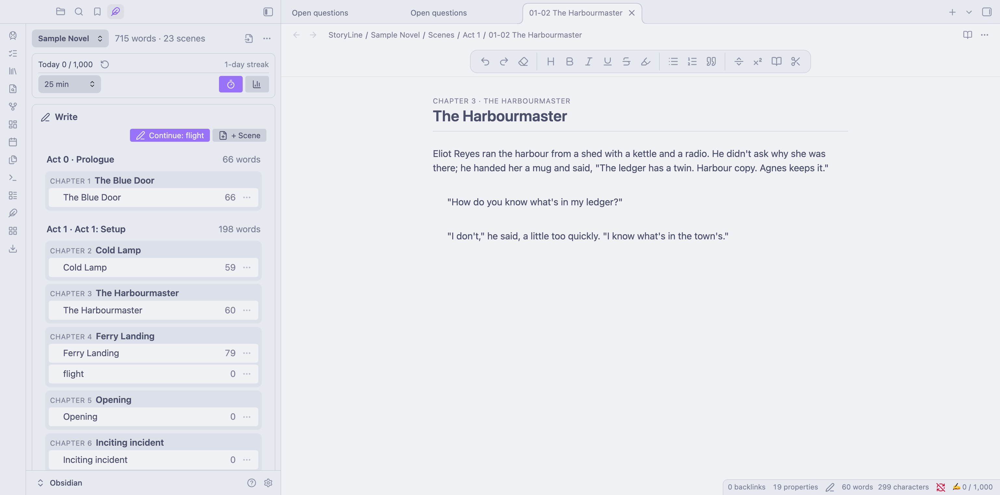

*The hub on the left, a scene open in the middle. The scene's chapter and title are drawn above the text.*


1. Run **Booker: Open Booker hub** from the command palette (or click the feather icon in the ribbon, which opens the hub on the left and the File info and Search panel on the right).
2. The **Today** card at the top lists five first steps: create your project, add a scene, write 100 words, add a character, add a place. It ticks them off for you and folds them away when you finish.
3. In the **Write** card, **Continue** opens the scene you were working on and **+Scene** adds a new one.
4. Use **Plan** to open the board, plotlines and timeline map.
5. Use **Codex** to add characters and places.

## 4. The hub

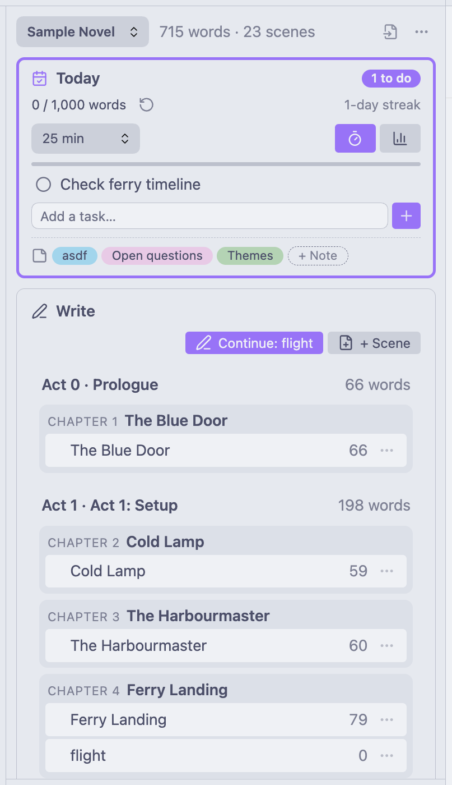

*The top of the hub: project picker, then the Today card (words, sprint, tasks and notes) and the Write card with your acts, chapters and scenes.*


The hub has these cards.

- **Today.** A small card with a bold accent-colour outline at the top. It starts with your words today against the daily goal (with a reset button), your streak, and the sprint timer with its **Start sprint** and **Stats** buttons. Under that it lists the first steps (create the project, add a scene, write 100 words, add a character, add a place), which tick themselves, and your own tasks: type one in the box and press Enter, click the circle to tick it, and click the × that appears on hover to remove it. Any first step can be hidden with its ×; **Show hidden first steps** brings them back. Once every first step is done they fold away. Under the tasks are your project notes as coloured pills (click to open) and **+Note**. Tasks are kept in `System/tasks.json`.

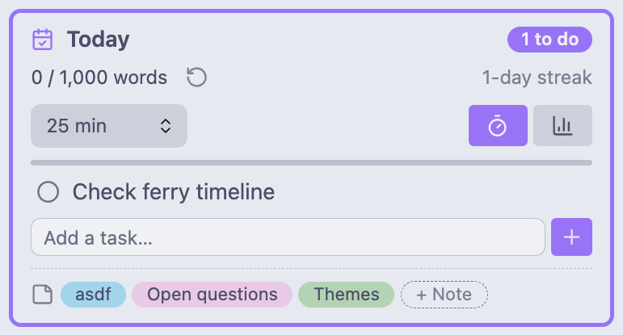

*The Today card.*

- **Write.** Your acts, chapters and scenes with word counts. Click a scene to open it.
- **Projects and Tools.** The hub's project dropdown lists every project (books grouped under their series) and ends with **New project…**. The hub's ⋯ menu (the dots at the top of the hub) starts with **Show properties in notes**, then has every view and command in labelled groups, then Project settings (Series settings when a whole series is picked). The bar at the top of the hub shows the tools that fit the open book (Settings can show them all): the Board, Plotlines, the Timeline map, Story checks, Writing stats, the inspector (the editable fields of the note you have open), the Documents and Reference library, and Export.
- **Plan.** A progress bar by scene status, and buttons for Board, Plotlines and Timeline map. The strip at the top shows today's words against your daily goal and your streak; the **Start sprint** button and a length menu sit below it, and **Stats** opens the full page.

Every project view (board, plotlines, timeline map, story checks, stats) follows the project picked at the top of the hub: change the project and the views that are open change with it.
- **Codex.** A list of what you have, chosen from a drop-down: characters, places, items, creatures, lore, culture, systems, notes, or a category you added. Each row shows the note's name with its date small underneath, a coloured dot when the note has a colour, and a number badge (#1, #2…) when the category is a sequence that is switched on. **Add** creates a new one (for a sequence category it opens the full new-item box). The **gear** opens the category's settings: auto-suggest for aliases, and **Sequence**, which can turn any category into a numbered, dated, linked list (see *Sequences for any Codex category*). In a sequence category, **Check** and **Repair** buttons appear beside the gear. **Add more** makes a new category, and can make it a sequence from the start.

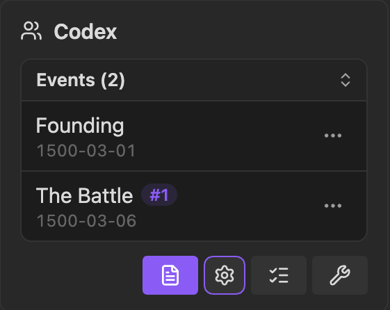

*The Codex card for a sequence category.*
- **Export.** Quick buttons for Word, ePub and PDF, then two larger buttons: **Custom Export** (formats, layout and advanced settings) and **Show folder**.

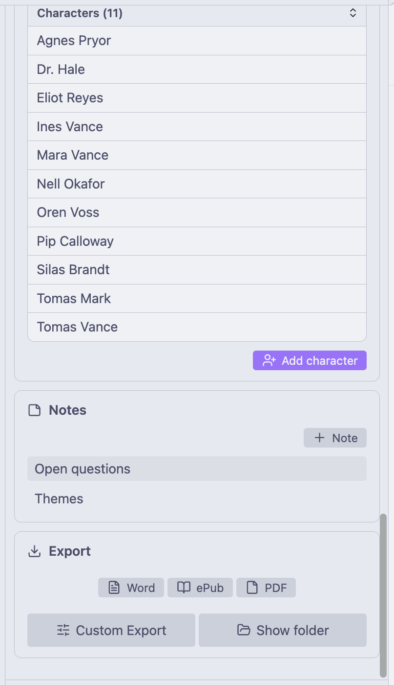

*The bottom of the hub: Codex and Export.*

The **Import** button beside the ⋯ menu at the top of the hub opens the window for bringing in a StoryLine folder or a Markdown manuscript (see *Importing a Markdown manuscript*).

The hub lives in the left sidebar. The right sidebar has a **Documents and Reference** panel (ribbon icon or the Open Documents / Reference panel commands): *Documents* lists your sources, adds and searches them; *Reference* inserts scripture and word studies, citations and footnotes into the note you were writing.

Buttons in Booker are grouped on the right. When a pane is narrow they lose their labels and show only icons. Hover for the name.

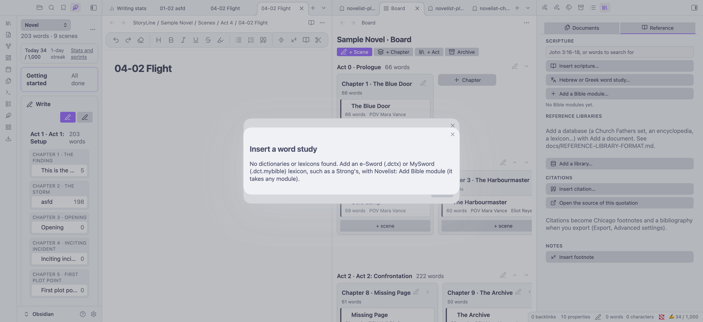

*A narrow hub shows icons only.*

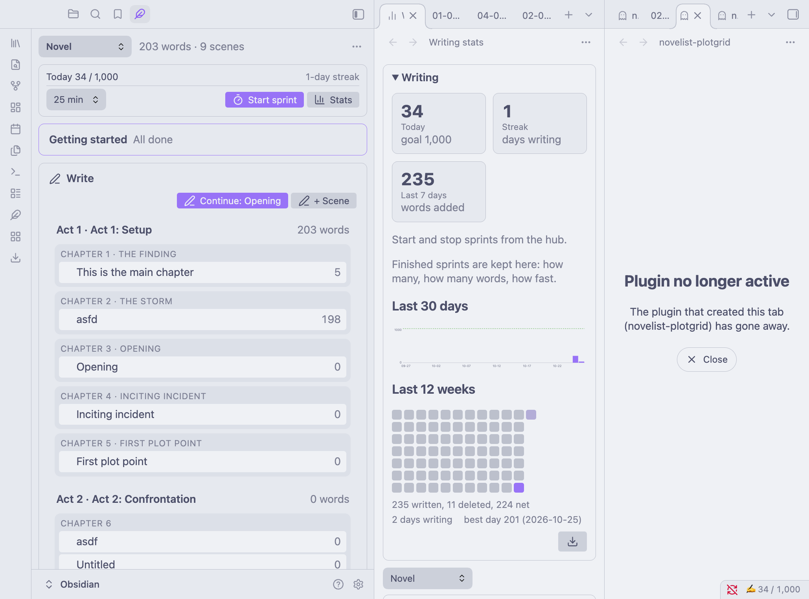

*The writing strip: today's words, the sprint timer and the Stats button.*


## 5. How your project is stored

A project is one folder in your vault, by default inside a folder called `Booker`:

```
Novel/
  Novel.md                 the project note (type: storyline)
  Scenes/Act 1/01-01 Title.md
  Codex/Characters/Name.md
  Codex/Locations/Name.md
  Codex/Items/ ...         other kinds
  Notes/  Research/  Archive/
  System/  plotlines.json  snapshots/  ...
```

A scene's file name starts with its act and its number in the book, such as `02-03`. Numbers are padded to two digits and grow past 99 without trouble. Booker renames files for you when you move scenes.

Act and chapter names, and empty chapters, are kept in the project note.

## 6. The board

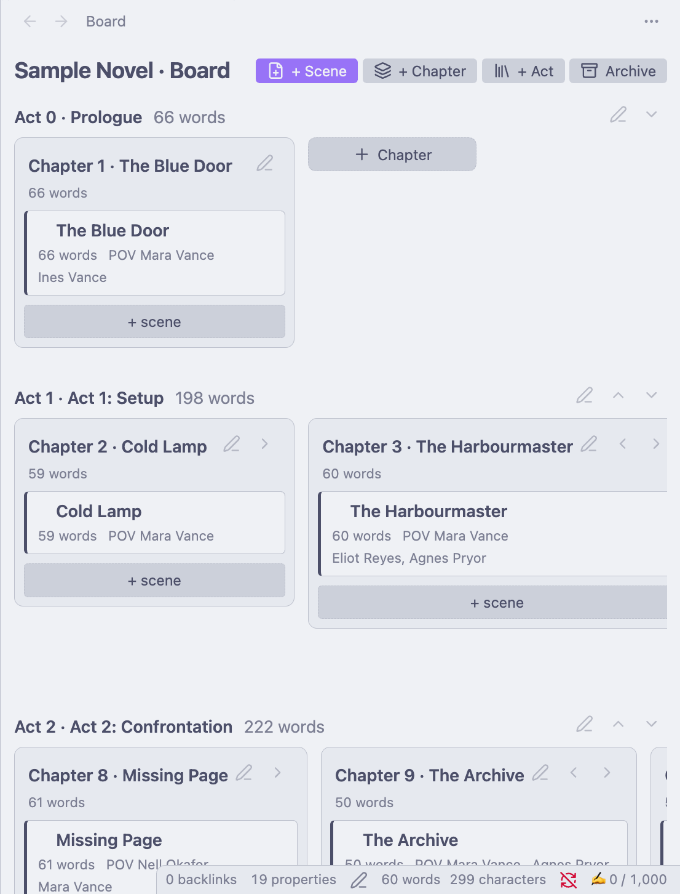

*The board: acts across the page, chapters as columns, scenes as cards.*


Open it from the **Plan** card or **Booker: Open board**.

- **+Scene**, **+Chapter** and **+Act** add to the board. A new act or chapter makes its folder straight away.
- Drag a scene to another chapter or act. Drag a chapter to move it.
- Click a name to rename an act or chapter.
- Act 0 is a Prologue.
- **Archive a scene** to take it out of the book without deleting it (an archived scene is kept in the project's `Archive/` folder, not in the manuscript or the export): right-click its card, or use Archive in the inspector. It moves to the project's `Archive/` folder and the scenes after it close up. The board's **Archive** button lists archived scenes; **Restore** puts one back at the end of the chapter it came from.
- Empty chapters stay until you remove them.

## 7. Plotlines

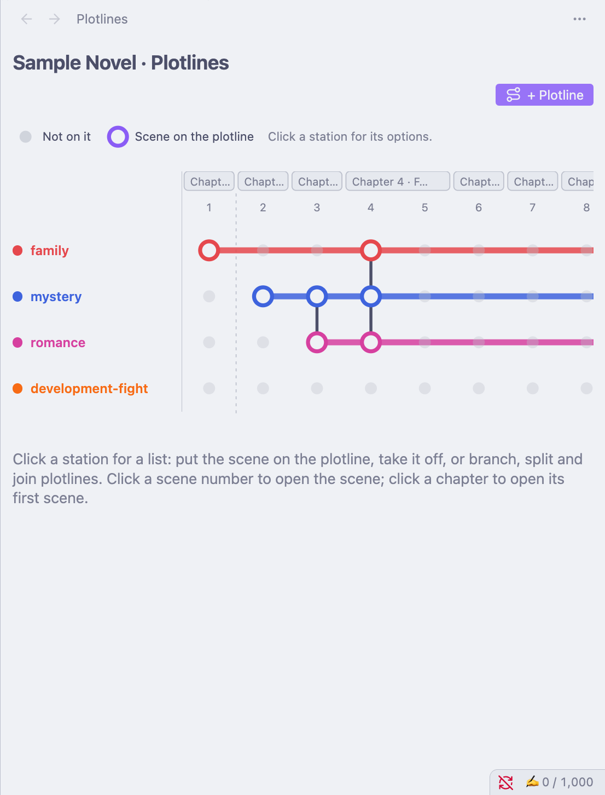

*The plotlines map: a lane per plotline, a station for each scene.*


A plotline is a **tag** on a scene, The map draws one lane per plotline and one column per scene.

- **Click a station** to open a short list for that scene on that plotline: *On this plotline*, *Setup* and *Payoff* (only when Setup and payoff tracking is on in Project settings), *Remove from plotline*, and the actions below. It is saved on the scene: the plotline goes in `tags`, setups in `plotline_setup`, payoffs in `plotline_payoff`.
- **Branch and split.** From a station choose *Branch a new plotline from here…* (a child plotline starts at that scene while the parent carries on), *Split into two subplots…* (the parent ends there and two named children start), or *Run into another plotline…* (the line joins another at that scene). Children sit under their parent with curved connectors, and a fork mark on the station shows where. The arrow beside a parent folds its subplots away.
- Plotline names stay at the left while you scroll. Each chapter has a band above its scenes; click it to open the chapter's first scene. Hover a scene number for its chapter and title, click it to open the scene.
- **Series.** For a book in a series, **This book** and **Whole series** switch the map (and the timelines) between one book and every book side by side.
- A scene on several plotlines is joined by a vertical line.

Colours, notes and the branches are saved in `System/plotlines.json`.

## 8. The timeline map

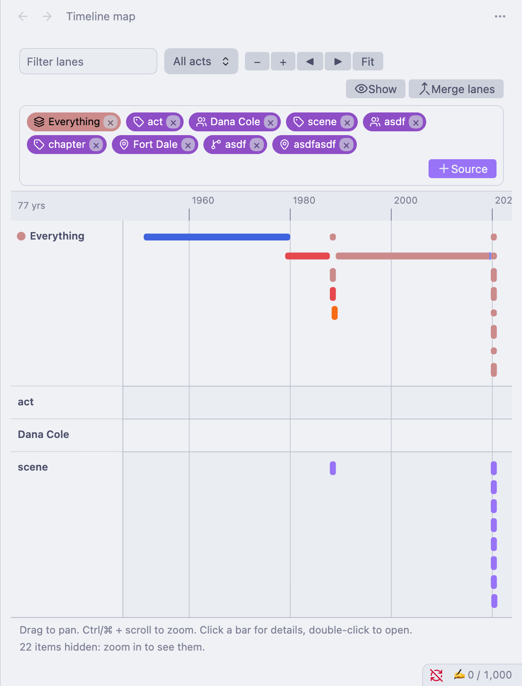

*The timeline map with sources as lanes and scenes as bars on a date axis.*


Open it from the **Plan** card. Anything with a story date can go on the map: scenes, lives, events, items, and any note in your Codex that has a **Date** property. Chapters and acts appear as spans worked out from their scenes.

Use **Source** to add a character, a place, a plotline, a life or a kind of element. Each source gets a lane holding everything connected to it, and items that overlap in time are pushed to rows below. **Merge lanes** puts all your sources in one lane. **Show** hides or shows kinds of element (acts are hidden to start with). Each source is a filled pill with an icon; press the pill (anywhere but the ×) to pick its colour, and the text switches between dark and light by itself. To colour a kind of element, add the kind as a source. A note's own **Colour** property wins. Your sources and colours are saved with the project in `System/timeline-map.json`.

#### Lives

A character can have several lives, such as one who is reborn. Open the character in the inspector and choose **+Life**. Each life is a note in `Codex/Lives` with its own dates. On a scene, the **Lives** field says which life the scene belongs to, and the scene then also counts for the character. Add the character as a source and you see their lives, scenes and chapters together.

Every scene that has a story date is a bar on a time axis.

- Zoom with Ctrl or Cmd and scroll, or pinch on a touch screen. Drag the background to pan. **Fit** shows everything.
- Choose lanes: by character, plotline, place or act.
- Drag a bar to move the scene in time, or drag its edge to change its length. The new date is saved in the scene's story date, and a notice offers Undo. A span is written as `1342-06-10..1342-07-01`.
- Click a bar for details, double-click to open the scene.
- Dates here can be written as years, months, days, years BCE, decades or "circa". A date the map cannot read does not show.

## 9. The inspector

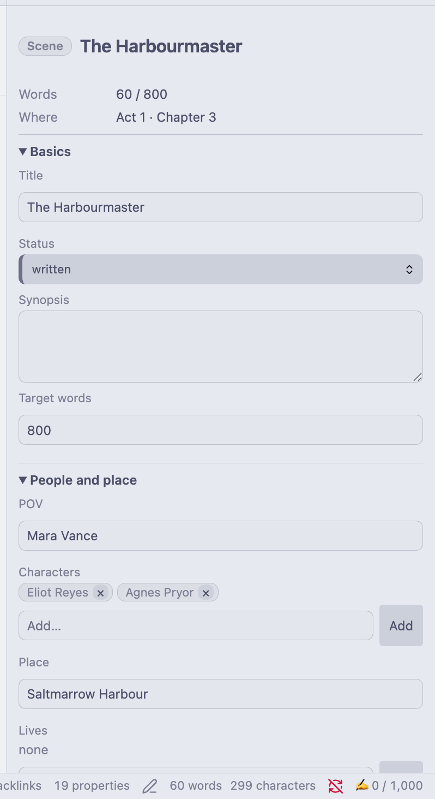

*The inspector panel for a scene: basics, people and place, dates, plotlines and the scene's other properties.*


Run **Booker: Open File info panel**. It shows the note you have open.

For a **scene**: status, target words, POV, characters, place, plotlines, date, time, time jump, conflict, emotion and intensity. **Find names** looks for characters and places in the text.

For a **codex entry**: aliases and the fields for its kind (a character has role, goal, flaws and so on; a place has description, atmosphere and so on), and the scenes it appears in.

For a **scene** there is one more section, **Beat**, which appears when the project follows a beat sheet and says which beat the scene is. When Setup and payoff tracking is on, **Setup and payoff** also lists the scenes this one sets up and the scenes that set it up; each link is written on both scenes (`payoff_scenes` and `setup_scenes`).

Changes are saved to the note's properties.

**Snapshots.** A snapshot is a saved copy of one scene at a moment you choose, for trying a rewrite without fear. **Take snapshot** saves the scene as it is now, with an optional label. Each snapshot has **Compare** (shows added and removed lines against the scene today), **Restore** (the current text is saved as a snapshot first, so a restore can be undone) and **Delete**. Snapshots are kept in `System/snapshots/`, so they never count as scenes.

**Project notes.** The hub's **Today** card lists the notes in the project's `Notes/` folder (themes, open questions) as chips and has **+Note**.

## 10. Characters, places and name detection

Add world notes from **Codex**. A character lives in `Codex/Characters`, a place in `Codex/Locations`.

When you pause typing in a scene, Booker looks for the names and aliases of your characters and places:

- A character found is added to the scene's `characters` list. A place found becomes its `location`.
- A first name counts. "Mike" can match Mike Anderson.
- If one word could mean two notes, a small box floats at the bottom of the scene and asks which. You can ignore it and keep writing. The name is only added after you answer. **Neither** skips it for this session.
- The text of the scene is never changed.

Commands: **Add characters and places found in this scene to its properties**, and the same for every scene. Settings control whether detection runs, capitalisation, and the pause.

## 11. Story checks and beat sheets

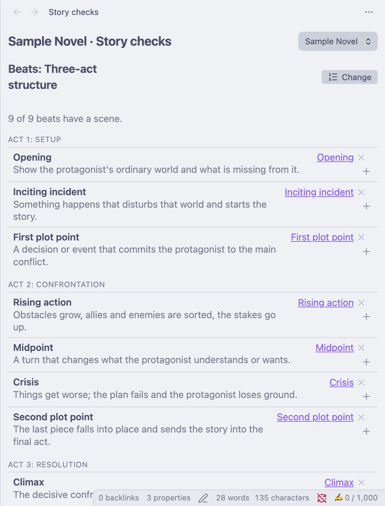

*Story checks: the beat sheet with the scenes that cover each beat.*


Open **Story checks** from the hub's ⋯ menu, or run **Open story checks**.

**Beat sheets.** **Choose a beat sheet** offers the outlines for the kind of book you are writing. Fiction has Three-act structure, Save the Cat, Hero's journey, Seven-point structure and Story circle. Sermon outlines have Expository, Topical, Narrative (the Lowry loop) and Gospel message. Christian non-fiction has a Doctrinal treatise and a Teaching book; History a Narrative history and a Thematic argument; Educational a Lesson cycle; Self-help a Transformation arc; Bible study a Weekly study rhythm; Reference an Entry template; Dictionary an Entry anatomy. You can add your own with `beatSheets` in a profile. Using one names your acts after it, remembers it in the project note (`activeBeatSheet`), and, if you leave the box ticked, adds a chapter and a scene for every beat with the beat's description as the scene's synopsis. The list then shows which beats have a scene. The **+** on a beat offers *New chapter for this beat* or *Link a scene or chapter…* (pick an existing scene or a whole chapter; linked scenes appear as chips on the beat, each with a × to unlink). A scene counts for a beat when its `beat` property names it, or when it was made from the sheet and still has the beat's name as its title. Using a sheet renames your acts, so use it on a new book or one whose acts you are happy to rename.

**Setup and payoff** is an optional template. Switch it on in Project settings, **Setup and payoff tracking**. Off, the marks on plotlines, the inspector section and this list are hidden; nothing already written is removed. On, the lower list shows every link from a setup scene to its payoff, and flags: a link to a scene that does not exist, a link recorded on only one of the two scenes (**Fix** writes the other end), a payoff that comes before its setup in reading order, and a scene linked to itself.

## 12. Writing mode

Booker can typeset the editor like a manuscript: a first-line indent, space between paragraphs, and a little extra before dialogue. This is only how it looks. Your notes stay plain Markdown.

- Turn it on or off with **Toggle writing format**, or in Settings, Writing format.
- **Tab** puts an indent at the start of the paragraph you are in, wherever the cursor is. It is a real em-space character, never a tab, so it never turns into a code block. **Shift-Tab** takes it away.
- **Enter** starts the next paragraph without carrying the indent.
- Lists, headings, quotes and tables keep Obsidian's own Tab and Enter.
- **Formatting bar.** Buttons above the editor for bold, italic, underline, strikethrough, heading, subheading, quote and scene break. They change only the selected text. Turn it off in Settings, Writing format.

If a paragraph already became a code block because of an old Tab, put the cursor in it and press Shift-Tab.

## 13. Open chapters in

Settings, **Open chapters in**, sets where a scene opens when you click it in Booker. The default is **the left pane** of the writing area; **Auto** uses another pane when there is one and splits to the right when there is only one. See *Where things open* for charts and other pages.

## 14. Exporting

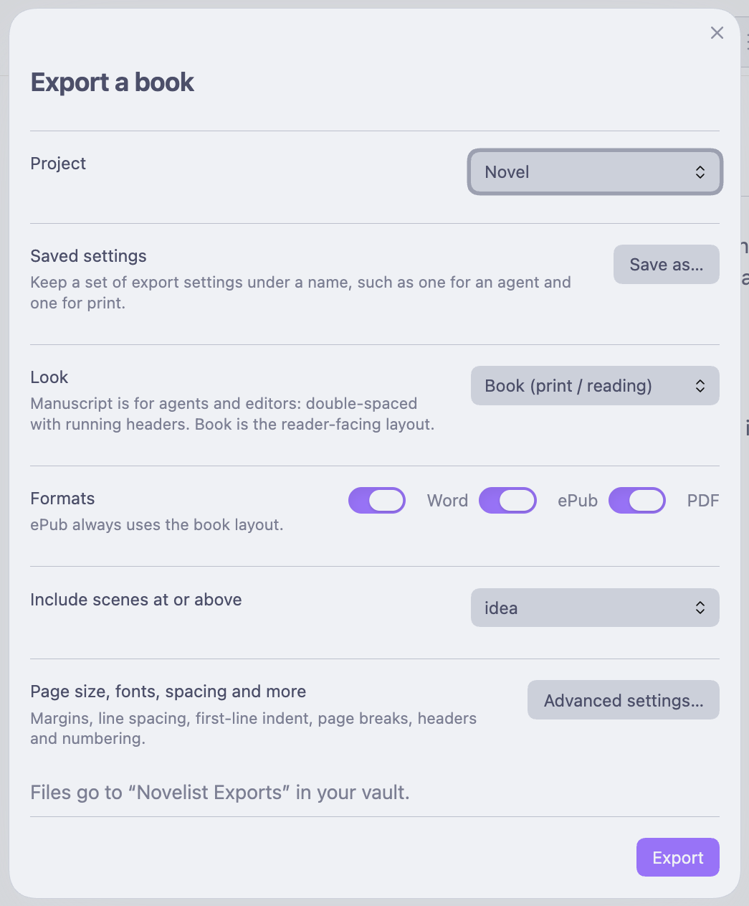

*The export window: formats, what to include and layout.*


Use the **Export** card, or **Booker: Export book**.

- Choose the project, the look (Manuscript or Book), the formats (Word, ePub, PDF) and the lowest scene status to include.
- **Options** opens the **Advanced export settings**: page size (or a custom size), top, bottom, inner and outer margins, font and size, line spacing, first-line indent, paragraph spacing, justification, a new page for each chapter or act, title pages, chapter heading style, act title pages, the scene break mark, page numbers, a running header, curly quotes, and whether each new line is a paragraph.
- Files go to your export folder (Settings, Export). The Export card has a button to show it.

Notes with `export: false` and your `Research` folder are left out.

## 15. Settings

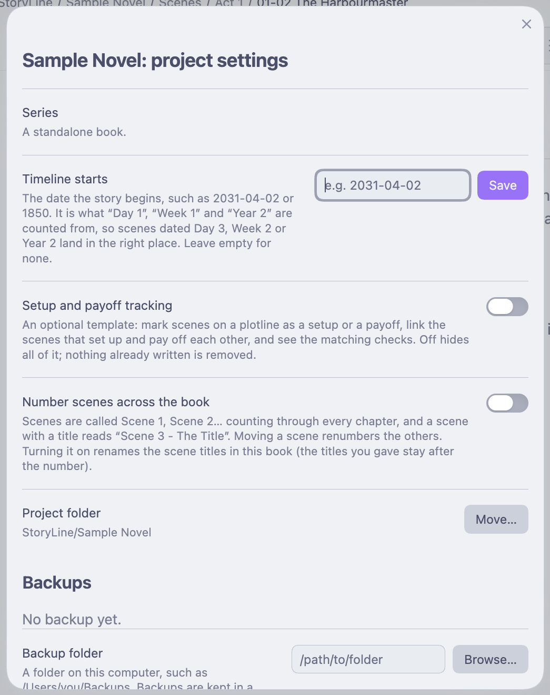

*Project settings: series, timeline start, scene numbering, project folder, backups and import.*


Booker's settings (Settings, Community plugins, Booker) are in collapsible groups. Each project also has its own settings, opened from the gear in the hub.

**Booker settings**
- **General:** where chapters and charts open, the folder for new projects, your own book templates, the ribbon.
- **Writing:** typeset scenes, indent after headings and scene breaks, Tab indents, hide properties and formatting marks, character and place detection, the daily word goal, the timeline.
- **Bible and reading:** the scripture bar, extra Bible modules, colouring what your notes quote.
- **Search by meaning:** models, indexes, scene summaries.
- **Dictionary and thesaurus:** the English dictionary (Open English WordNet) and thesaurus (Moby) come with Booker and are added to your library the first time it starts on a computer (see *Dictionary and thesaurus* below). Turn word suggestions on or off. The Resource manager can still download the older Princeton WordNet 3.0.
- **Export:** folder, author name, surname for headers, contact block, scene break mark, lowest status, print trim size.

**Project settings**
- **Levels** (at the top): name each level and add or remove levels. With three levels (for example Part, Chapter, Scene), the minus button merges each chapter's scenes into one note, joined by your scene-break mark. The plus button splits each chapter back into scenes wherever it has a scene break (`***`, `---`, `___` or `* * *`); a chapter with no break stays one scene. Both ask first and show what will change. When scenes are merged, every scene's summary goes with the merged note (one line per scene, headed by its title) instead of only the first scene's, and the short AI summary, which described just that first scene, is dropped to be written again. The board and the hub show a note's summary under its title, or its description when it has no summary. Renaming a level renames it everywhere.
- **Book, Structure, Writing aids, Backups, Import:** project health and format, series, folder, numbering, setup and payoff tracking, timeline start, name and verse detection, backups, and manuscript import.

**Front and back matter** pages drag like chapters: a glow shows where the page will land, and you can drop one at the very top.

**Dictionary and thesaurus** (right panel): look a word up, see its senses and synonyms, and click a synonym to replace the word you have selected. Select a word and use Look up in the right-click menu. Under *Suggest richer words as I write* (off by default), a bar of SAT-level alternatives appears over a plain word as you write it, like the scripture bar. Click one to swap it in. Shift+Space right after any word (a Bible reference is handled first) swaps in the first suggestion, or the first synonym if the word isn't on the richer-words list; press it again to step through the others, and once more to get your own word back. The bar stays up while you step, with the word now in your text highlighted (you can click any of them). Move the cursor away and the stepping starts over; come back to the new word and its own synonyms are offered. Hovering a word shows the bar too.

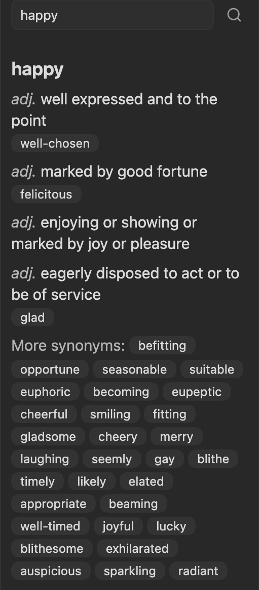

*The Dictionary card. Under each sense are the dictionary's synonyms for that sense; **More synonyms** at the bottom comes from the thesaurus.*

**What comes with Booker.** The dictionary is **Open English WordNet** (2025 edition: definitions and synonyms by part of speech and sense) and the thesaurus is the **Moby Thesaurus** (about 30,000 words, each with a long list of related words). Both are inside the plugin folder, so nothing is downloaded. The first time Booker starts on a computer, a background task adds them to your library (`Booker/Library`; about 55 MB of disk in your vault). Phones and tablets do not add them. If you delete one from the library it is not added again.

**More synonyms** lists the thesaurus's words for the word you looked up, best first. The thesaurus has no order of its own, so Booker ranks each word by how many neighbours it shares with yours; the closest in meaning come first. The thesaurus is loose by nature: expect near-synonyms and associations as well as exact ones. The same words feed the suggestion bar and Shift+Space, after the dictionary's own synonyms.

If the older Princeton WordNet 3.0 is also in your library (from the Resource manager), Booker uses Open English WordNet. Open English WordNet is licensed CC BY 4.0 and is derived from Princeton WordNet; the Moby Thesaurus is public domain. The licence texts are in the plugin folder under `dictionaries/LICENSES` and in `THIRD_PARTY_NOTICES.md`.

## 16. Working with a co-author

Share the vault folder with the Collaborative Folders plugin. Scenes are plain notes, so edits merge. Booker's writing mode only adds line classes to the editor, so live cursors keep working. Settings, stats and exports stay personal.

## 17. Known limits

- **Older Booker format.** 0.4 does not read 0.2 projects (series, books, lives, `_Codex`) and has no importer.
- **Removed from 0.2.** The dashboard, the ribbon menu, the right-click menu, the folder-note option and the New series / New book / New life commands are gone. Word counts for the status bar and Writing stats come from your scenes.
- **Not built yet.** Scrivener and spreadsheet import are not planned. RTF files are imported (see the Import button).
- **Not tested by hand.** Real touch and mouse dragging on every view, PDF and ePub appearance, and live cursors with Collaborative Folders.
- **Sequences.** The *Items can be anchored to* choices record what a category is meant to follow and add a character link to new items; they do not stop you anchoring to any note. Repair recomputes start dates (an item keeps its length). Dragging an anchored item on the timeline does not change its anchor, so Check will report it until you change the anchor or gap. Lives from before this version are sequences too, and a gap you set by hand that is not the default will be reported as *dates differ*.
- **Map.** The real world is drawn with WebGL, or with the simpler compatible map (no pin clustering, less detail) when WebGL is missing or slow. It shows country and state borders, not streets or town names. A picture is shown whole and is not tiled, so very large pictures (above about 16 megapixels) may be slow on a phone: import a scaled copy. Finding a place by name or zip needs the place data downloaded on a computer first (type coordinates instead on a phone). It looks up cities of 15,000 people or more, not villages or street addresses. The postal-code list is large (about 130 MB on disk) and is read when you type a zip.
- **Dictionary on phones.** The built-in dictionary and thesaurus are added on a computer only.

## 18. Troubleshooting

- **A view is blank.** Make sure a project exists (run the hub and follow the Today card). Then reload the plugin: Settings, Community plugins, turn Booker off and on.
- **A scene did not appear on the board.** It needs `type: scene` in its properties and must be under the project's `Scenes` folder.
- **A name was not detected.** Check the character or place note exists under `Codex`, that detection is on in Settings, and that capitalisation matches if that option is on.
- **Check says "dates differ".** An item's date is not where its anchor and gap put it. Run **Repair** and read the preview: it shows each change as *old → new*. If you set the date on purpose, change the item's anchor or gap instead (in the inspector's Time link box), or switch the category's sequence off.
- **A sequence category's Add box is just a name.** Its sequence is switched off. Open the gear and turn **Enabled** on.
- **No dictionary on a phone, or "No English dictionary" on a computer.** The dictionary is added the first time Booker starts on a computer and takes a moment. If you deleted it from the library it is not added again: open the Resource manager and download WordNet.
- **Numbers in file names look odd.** The first number is the act and the second counts through the book. Booker keeps both up to date when you move scenes.

## Timeline start and relative dates

When you create a project, **Timeline starts** asks for the date the story begins (for example 2031-04-02 or 1850). It is saved on the project note as `timeline_start`. Scenes can then be dated **Day 3**, **Week 2**, **Month 4** or **Year 2**, counted from that date: Day 1 is the start day itself, Week 1 is its first seven days, Year 2 starts one year after the start. Change the start date later with the gear icon at the top of the hub (**Project settings**). Project settings also **moves the project folder** to another place in the vault (not for books of a series yet), and has an **Import chapters or sections** button; the same import is under the hub's Import button. Without a start date, “Day 3” is not placed on the timeline maps. Dates can also be written 4/2/2031 (month first), Oct 2 2031, 1850, 1900s or 19th century.

## Series in the hub

Books of a series are grouped in the hub's project dropdown. Pick **All books in <series>** to see the whole series: its books (press one to open it), **+Book**, the Codex the books share, and Plotlines, Timeline and Timeline map across every book. The board, notes and export work on one book, so pick a book for those.

## Continuity checks

**Story checks** also has a **Continuity** section. It reads your scene properties and lists things worth a second look: a plotline marked as a *setup* with no later *payoff* (and a payoff with no setup before it), a plotline that disappears for eight scenes or more, a story date earlier than the scene before it (unless the scene is marked a flashback or similar), and a character in two different places on the same day (skipped when a time of day is given). They are prompts, not errors; press **Open** to go to the scene. Day, Week and Year dates are counted from the project's timeline start.

## Series settings

With **All books in <series>** picked in the hub, the gear opens the series settings: rename the series and put its books in reading order with the arrows. The order is used when the whole series is shown.

## Stats

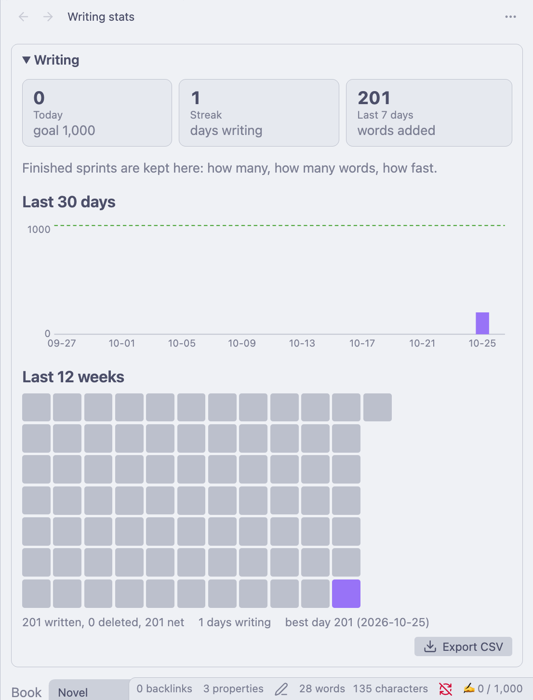

*The Stats page.*


Open **Stats** from the Plan card's strip or the ⋯ menu. It follows the hub's project and is in sections you open and close:

- **Today.** Words against your daily goal, your streak, and the **sprint timer**, which lives in the hub's top strip: pick a length (10 minutes up to 2.5 hours) and press **Start sprint**. The clock counts down, shows the words you have typed since the start, and a notice appears when time is up with your words and pace. Only words you type count.
- **Overview and progress.** Total words, scenes, estimated reading time, scenes by status, and words per act and chapter.
- **Writing history.** Words added, deleted and net by day, active days, and a 12-week activity grid.
- **Sprint history.** Every finished sprint (kept between restarts): count, words, average words a minute, and totals for today, the week and the month.
- **Prose analysis and echo finder.** Dialogue against narrative, reading ease and grade level, average sentence and word length, your most-used words, and repeated words and phrases close together. It reads only the scenes that changed since last time.
- **Characters and point of view.** Scenes per character and point of view, and how often each place is used.

## Backups

**Project settings, Backups** keeps copies of a whole project somewhere safe. Choose a **backup folder** (any folder on a computer; on a phone or tablet, a folder inside the vault), **how often** (only when you press the button, hourly, daily or weekly) and the **kind**: *Full* writes a zip of everything each time; *Incremental* writes one full zip and then copies only the files that changed (and notes the ones removed), starting a new full zip every ten runs. **Full backups to keep** deletes the oldest ones, with the incrementals that depend on them. Backups run while Obsidian is open and catch up when it starts; nothing is written when nothing changed. **Back up now** runs one at once. **Restore…** lists the backups and rebuilds the chosen moment as a new folder next to your project, `<Project> restored <date>`, so your own files are never overwritten. A book of a series can include the series' shared Codex.

## Footnotes

Write footnotes the way Obsidian does: put `[^1]` where the mark goes and `[^1]: the note` on its own line anywhere in the same note, or write the note on the spot as `^[the note]`. **Insert footnote** (command palette, or the superscript button in the formatting bar) adds the next numbered mark at the cursor, adds its line at the end of the note and puts the cursor there to type. A mark with no note, and a note nothing refers to, are left out of the export; notes are matched within one scene, so each scene can use `[^1]` again.

In the export window, **Advanced settings, Footnotes** chooses where notes are printed and how they are numbered:

- **Foot of the page**: real footnotes in Word (Word numbers them straight through the book). In ePub the notes sit at the end of the chapter, linked both ways and shown as pop-ups by readers that support it. In PDF they are set at the foot of the page under a short rule, and a very long note carries over to the next page.
- **End of each chapter**: a short *Notes* list after each chapter, numbers starting again at 1 (or running on, if you choose).
- **End of the book**: one *Notes* section at the back, grouped by chapter.

## Scripture

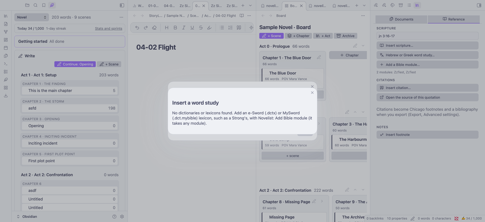

*A verse inserted into a scene from the Reference panel.*


**Insert scripture** (command palette, or the open-book button in the formatting bar) puts Bible text into the note at the cursor. Type a reference such as `jn 3:16-18`, `1 Cor 13:4-7a`, `Rom 8:28, 31`, `Ps 23`, `Gen 1:1-2:3` or `Ps 119:105; Prov 3:5`, or type words to search the translation and press a result. The passage appears as it will look; **Enter** inserts it. Selected text in the note starts the box.

Booker reads **your own** Bible files and ships none: e-Sword (`.bblx`), MySword (`.bbl.mybible`), and OSIS, Zefania and USFX XML (including the Apocrypha). Drop them on the **Documents** tab (or use **Add Bible module**): they are kept in `Booker/Library/Bibles`. Modules in the older `Booker/Bibles` folder, or the extra folder named in Settings, Scripture, are read as well. Modules bought from a publisher are often locked by the seller and cannot be read; free and unlocked ones open. Commentaries open in the Bible reader beside the verse; dictionaries are recognised but not used yet.

The window's menus set how the quotation looks, and remember your choices: block quote, inline quote or plain text; verse numbers raised, in [brackets], plain or none (a single verse is not numbered); the reference after, before, in brackets or left off; book names in full, SBL form (1 Cor) or short; the translation tag; each verse on a new line; words of Jesus in italics. Words the translators added show in italics if the module marks them.

For a single verse, the **a b c** buttons quote only part of it: Booker splits the verse at its clauses (hover a letter to see its words), and the reference reads `John 3:16b`. The split is a guess at where you would cut, since modules store whole verses. A quotation that starts or stops mid-verse gets an ellipsis. Verse numbers are real superscripts in Word, ePub and PDF.

## Scripture help while you write and the Bible reader

- **Type a reference** (for example `John 3:16`) and a small bar with **Insert** and **Read** appears above it for a few seconds. It also appears when the mouse rests on a reference that is already in your text.
- **Insert** replaces the reference with the verses, in your default Bible and verse style. **Read** opens the passage in the Bible reader.
- **Shift+Space** does the same as Insert, but only straight after a reference you have just typed. Anywhere else it is an ordinary space.  Turn the bar and Shift+Space off under Settings → Scripture bar.
- **The Reader** (the Research card's Bible reader button, the hub's tool bar, or the command *Open Bible reader*): one reader for the Bibles, the commentaries and the whole library. A bar across the top shows where you are: **Back and Forward** (left of the search box) step through the places you have been (so a jump from a verse into a commentary and back is one click); the **Source** button (a Bible's name, or Libraries) opens a list of every Bible, commentary and library; the **Place** button opens a picker for where to read (books in Old and New Testament groups with a grid of chapters, or the levels of a work), with arrows either side for the previous and next chapter or entry. The **one box** under the bar does the rest: type a reference such as *John 3:16*, *Ps 23* or *Romans* and it opens by itself after a short pause; type the start of a book (*rom*), or the name of a Bible, a commentary, a library or a work (*augus*), and pick from the suggestions with the arrow keys and Enter; type anything else and Enter searches (see *Searching the readers* below for the two small boxes at its right). **Contents** shows or hides a side drawer (books and chapters, or the tree of a work). Click a verse and press **References**: a tab of its own opens beside the reader (to the right, or to the left from the small arrow next to the button; Booker remembers your choice) and shows the commentaries on that verse, with a search of your documents for the reference. It follows the reader as you pick verses and change chapters; the pin button at its top keeps the verse you are on, and pressing it again catches up. "Read more" opens the full note, and **Open commentary** opens the whole commentary at that verse in the Reader. The **⋯** menu changes the text size, opens a document and adds a Bible module. The place you were reading, and the history, come back when you reopen the pane. The command *Open the Bible references tab* does the same from the command palette.

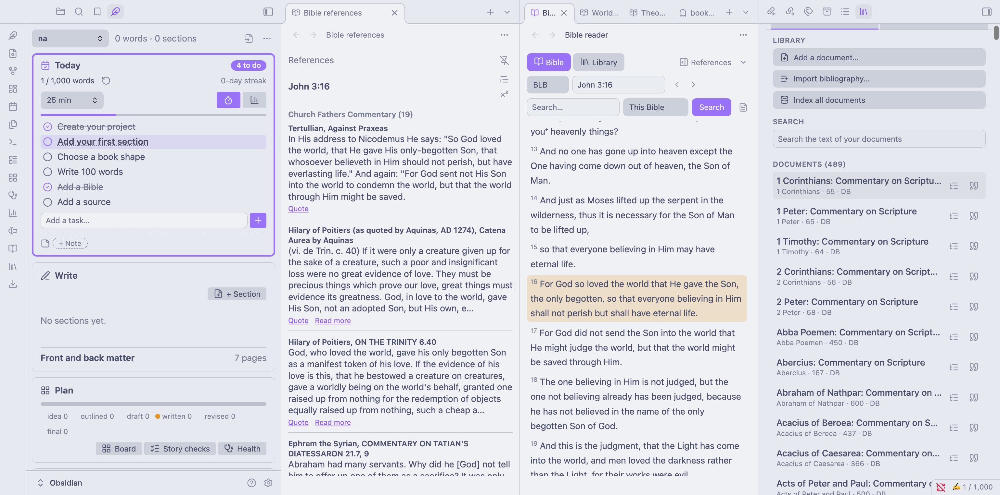

## From the readers into your text

- **Bible reader:** beside a verse, the book-and-quote icon writes the verse out, and the superscript icon writes it out *with a footnote* naming the Bible, such as "Berean Literal Bible (draft), John 3:16." Each commentary note has a **Quote** link: it writes the words as a block quote with a footnote saying who wrote them, in which commentary, and on which verse.
- **Insert scripture window and the Reference tab** both have a button to open the Bible reader on the same passage.
- **Highlights in the source reader:** right-click a highlight to change its colour (yellow, blue, green, pink), add or edit a comment (shown when you point at it), or remove it.

## Clickable references

In reading mode, and in the commentary in the Bible reader, a scripture reference such as John 3:16 is underlined: click it to open the passage in the Bible reader. A citation `[@key, 4]` shows the full bibliography entry when you point at it and opens the source when you click; a key that matches no source is shown in red. In the Documents panel, the list icon beside a document shows every place in your books that cites it, and selecting a scripture reference inside the source reader adds a **Read** button.

## Tools that fit the book

Each kind of book shows the tools it needs. A non-fiction book gets **People, Places, Key terms and Passages** under *Codex* (instead of Characters, Items and Creatures), a **Research** card in the hub (Bible reader, Sources, Add source, Health) and a getting-started list that asks for a Bible and a source. The Board, Plotlines, Timeline, Family tree and Stats icons (in the left ribbon, and in the bar across the top of the hub) appear only when the open book's kind has them, and the Bible reader and Documents icons appear only for books that quote and cite. A novel therefore shows no Bible reader. Every tool stays in the command palette, and *Settings → Show every tool in the ribbon* brings them all back.

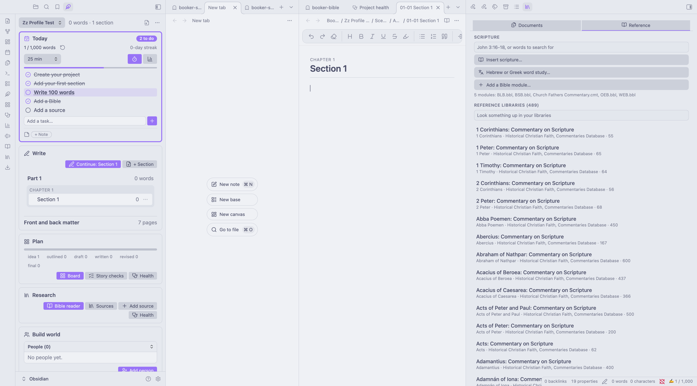

## Right-click menu, citing and callouts

Right-click in a note that belongs to a Booker book and the menu gains Booker actions that fit where you clicked:
- **On a scripture reference:** Read it in the Bible reader, or write out the verses.
- **On a `[@key]` citation:** Open the source (or see that no source has the key).
- **Anywhere:** Cite a source…, Add footnote, Insert scripture…, Hebrew or Greek word study…, and *Wrap as* Epigraph, Chapter summary or Discussion questions (the selected text goes inside the box).

The formatting bar has a **Cite** button (@) and a callout button beside Insert footnote. Typing `[@` opens a list of your sources: keep typing to narrow it, pick one, and `[@key, ]` is written with the cursor ready for the page number. The commands *Insert epigraph*, *Insert chapter summary* and *Insert discussion questions* can be given hotkeys in Obsidian's Hotkeys settings.

## Project health

The *Project health* row in the export panel (stethoscope button) reads the whole book, shows a one-line count of the warnings and, when opened, lists what needs attention. The command *Open project health* opens the same list as a full pane:
- **Citations:** a `[@key]` that matches no source, and sources you added but never cited (reference libraries are not expected to be cited).
- **Footnotes:** a `[^1]` mark with no note text, a note nobody uses, and a note written twice.
- **Scripture:** a reference the default Bible cannot find (for example John 3:99).
- **File info:** a character or place listed in a scene's file info that no longer appears in the scene's text (by name, alias or first name; a name inside a link counts), and a setup or payoff scene that does not exist. The POV character is never flagged as missing from the text, since a first-person scene may not name them. Each stale name has a **Remove** button, and the group has **Remove all**; they take the name off the file info only, never out of the text.
- **Missing notes:** a person (including the POV character) or place named in a scene's file info that has no Codex note. **Approve** creates the note; **Approve all** creates every one. A place gets its coordinates from the scene that names it: the real-world position and the position on each drawn map that scene has. A name several scenes share is made once. Creating notes is one step you can undo.
- **Unfinished:** a scene with no text, and a scene still at one of its book's first two statuses (for example *idea* or *outlined*).

Spelling is not checked here: Obsidian's own spell checker does that as you type.

Click a line to jump to it. Story checks (beats, setup and payoff, continuity) are one button away. When you export, Booker also tells you in a notice if a citation matched no source and was printed as typed.

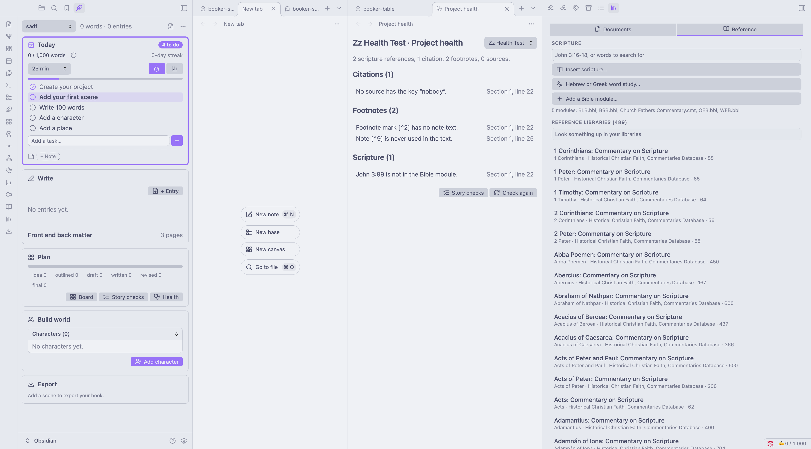

## Scripture index

Non-fiction books can end with a **Scripture Index**: every reference found in the chapters (such as `John 3:16`, `1 Cor 13:4-7a` or `Romans 8`), grouped by book in Bible order, each with the chapters it appears in. It is on by default for templates that list one (Christian non-fiction), and any book can switch it on in the Advanced export window under *Footnotes and sources*. Back matter and the bibliography are not scanned.

## Glossary, Ibid. and marking index terms

- **Glossary:** write a back-matter page called Glossary with one entry per line, such as `Grace: unearned favour` (a dash works too, and a line that continues the one before joins it). On export Booker sorts it A to Z and sets each term in bold. A page that does not look like a list of entries is printed as you wrote it.
- **Ibid.:** in the Advanced export window, *Use “Ibid.”* makes a Chicago or SBL note that cites the same source as the note before it read “Ibid.” (with the page when there is one).
- **Mark for index:** select a word or name in a note, right-click and choose *Add “…” to the index*. It is added to the book's index terms. An epigraph callout prints in italics.

## Index

Add an **indexTerms** property to the book's project note (open it in Properties as a list, or type `grace, faith, covenant` on one line). When you export, Booker prints an **Index** at the end of the book: each term that occurs as a whole word, in any capitals, with the chapters it appears in, in A to Z order. Terms that never occur are left out. If the book also has a back-matter note called Index, the generated index replaces it. Switch it off in the Advanced export window under *Footnotes and sources*.

## Sources

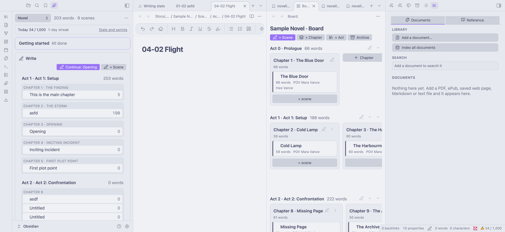

*The Documents and Reference panel on the right, beside the hub and a scene.*


**Booker: Add source** adds a book, article, PDF, ePub, saved web page, Bible module or Markdown file to your library. Each source gets a small note in the Sources folder with its citation details (author, title, publisher, place, year and so on); the file itself stays where it is, so large collections do not become thousands of notes. **Search sources** searches the text of everything in the library (or one source) and shows a snippet with its page, chapter or paragraph.

Open a source in the reader, select text and choose **Highlight**, **Quote** or **Cite**. Highlights are saved with the source (with a little of the text around them, so they survive a re-import), can have a colour and comment, and a link back opens the original at that spot. **Quote** inserts a block quote followed by a citation `[@key, p. 45]`; **Cite** inserts only the citation.

## Resource manager

Booker only goes online when you press a Download button. The **Resource manager** lists everything you can download: the search models and the writing model, the place data the Map uses to find a city or zip (under **Maps**), reference libraries found so far (Church Fathers, Josephus, Bibles, medieval sources, papyri) and every work in the Christian Classics Ethereal Library (CCEL). Open it from the **Resource manager** button on the Import card, from Settings → Search by meaning, or with the command *Resource manager*.

Each download runs in the background: the circle in the hub spins and the task viewer shows its progress, with a Cancel button. Downloads are checked (size and checksum for models) and a cancelled or failed one leaves nothing half-written. Models go in the plugin's `models` and `models-gen` folders; libraries are added to your library.

**CCEL.** *Choose…* opens CCEL's own list of about 1,300 works (as ThML, their markup), which you can filter and tick. Each is turned into a Booker library, grouped under *Christian Classics Ethereal Library*. CCEL asks programs to wait 10 seconds between requests, and Booker does, so about 100 works take 20 minutes and all of them several hours. Stopping is safe: works already added are skipped next time. The editions are mostly public domain, but CCEL claims their formatting, so keep them for your own use.

**Tertullian.org and Fordham.** The same *Choose…* list. Tertullian.org gives about 150 works (Roger Pearse's translations, a library each, one section per web page); most are already inside the Church Fathers: Writings database. Fordham's Internet Medieval Sourcebook gives about 30 topics (the End of Rome, Islam, the Crusades, law texts…), a library each with every text a section; a topic holds up to a couple of hundred texts and Booker waits 2 seconds between requests, so a large topic takes about ten minutes. Fordham asks that you not republish its pages, so keep them for study. Both sites' `robots.txt` rules are followed.

**Church Fathers (HistoricalChristianFaith).** *Download and add* fetches the whole GitHub repository once (about 290 MB for the Writings, 130 MB for the Commentary), makes one library per author or Father, adds them, and deletes the download. The Writings become about 150 author libraries; the Commentary about 325, one per Father, with the Fathers' comments under each Bible passage (the folders named after Bible books hold that book's own quotations of the Old Testament). Authors you already have are skipped.

**From a terminal.** `node scripts/fetch-resources.mjs` does the same with the same rules: `list`, `models --plugin <booker folder>`, `site ccel|tertullian|fordham --out <folder> [--match text] [--limit n] [--dry-run]` and `archive hcf-writings|hcf-commentaries --out <folder>`. It writes `.nlib` libraries into the folder; run it again to carry on, then drop the folder on the Import card. Libraries marked *Download here is coming* (Monergism, Josephus, the Bibles, the papyri) open their web page for now. Downloads need the desktop app.

## Reference libraries (databases)

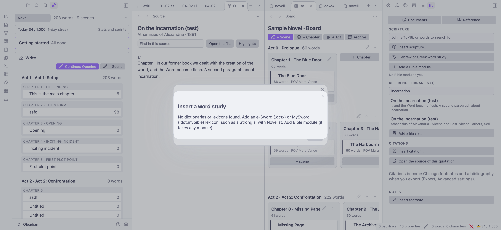

*Reading a reference library entry.*


## The library folder

Everything you add lives in one folder, `Booker/Library`, with three subfolders: **Bibles** (Bibles and commentaries), **Databases** (reference libraries, dictionaries and other SQLite databases) and **Documents** (PDF, ePub, web pages, Markdown, Word). Copy the whole folder to another vault or another Booker install and it works as it was.

The **Documents** tab has a drop zone: drop files, or a whole folder, and Booker works out what each one is and where it goes. *What can I add?* lists the kinds it understands. Word, OpenDocument and RTF files are turned into Markdown on the way in. A folder from another Booker install (documents or libraries with their notes) is copied across as it was, and skipped if it is already in your library. Each database has a three-dot menu with **Fields and navigation…**: for a database that is not a Booker library you choose the table and which column is the title, key, text, place and parent, and which of title, key and place show when browsing. The choice is saved beside the database. Use the command **Move my Bibles and documents into Booker/Library…** to bring an older library (`Sources`, `Booker/Bibles`) across; nothing is overwritten.

Besides documents, the library takes databases: a **Booker library** (`.nlib`) or an e-Sword/MySword dictionary (`.dctx`, `.dct.mybible`). A library holds a work or reference book as a tree of entries (a Church Father's treatise by chapter, an encyclopedia, a lexicon, a catechism, a collection of creeds), each with a place to cite it from. It is searched with everything else, opens in the reader at the matching entry, and is quoted and cited like any source. The **Reference** tab lists them and has a lookup box that searches only your libraries. The format is a small SQLite file described in `docs/REFERENCE-LIBRARY-FORMAT.md`; `scripts/make-nlib.mjs` builds one from a JSON file.

## Importing a bibliography and looking up references

**Import bibliography** (Documents tab, or the command palette) reads a BibTeX (`.bib`), RIS (`.ris`) or CSL-JSON (`.json`) file from Zotero, EndNote, Mendeley and similar tools. Each entry becomes a source with its citation details and the key it had before, ready for `[@key]`. Entries already in the library are skipped.

**Look up the scripture reference at the cursor** finds a reference such as John 3:16 or 1 Cor 13:4-7a around the cursor and opens the Insert scripture box on it, so you can preview it, change the translation or style, and replace it with the quotation.

## Citations and the bibliography

Write `[@key, p. 45]` in the text. In the export window, **Advanced settings, Footnotes and sources**, citations become Chicago notes-bibliography footnotes (the first mention in full, later ones short) and an optional **Bibliography** is added at the back with only the sources you cited. SBL, APA and MLA are also available (choose the style in the same window).

## Hebrew

Hebrew text, with vowel points, runs right to left in Word, ePub and PDF exports (a Hebrew font is built in for PDF). Search ignores vowel points and accents. **Insert Hebrew or Greek word study** looks a word up in a lexicon you own (an e-Sword `.dctx` or MySword dictionary, such as a Strong's) by number, word or English meaning, lets you edit the Hebrew, transliteration, meaning and Strong's number, and inserts it in the line of text or as a block quote.

## Saved export settings

In the export window, **Saved settings** keeps the current choices (look, formats, status filter, Advanced settings) under a name, such as “Agent” or “Print”. **Save as…** stores them (the same name replaces the old set), the dropdown loads one, and the bin deletes the one you have loaded.

## Mirrored margins

In **Advanced settings**, **Mirror margins on facing pages** keeps the inner margin next to the binding on every page: Word's “mirror margins” setting, and the same behaviour in PDF. It is on by default for the Book look and off for Manuscript. ePub is not affected, because ePub text reflows and has no fixed pages.

## Series: checks, export and moving books

- **Story checks** has **This book / Whole series** for a book in a series. Whole series checks setup and payoff and continuity across every book in reading order (beat sheets belong to one book and are hidden). The series view in the hub opens it that way.
- **Export** lists **All books in <series> (one manuscript)**. Each book becomes a part named after the book, chapters are numbered on through the series, and the series name is the title. The series view in the hub has an **Export the series** button.
- **Project settings, Series** moves a book into a series (**Add to a series…** / **Move to another series…**) or out to stand alone (**Make standalone**). The folder moves, `series.json` is updated, and a standalone book's Codex entries join the series' shared Codex (an entry whose name is already taken stays in the book's own Codex folder).
- The board and notes stay one book at a time; switch books with the project dropdown.

## Formatting bar, splitting scenes, scene breaks in books

The bar above the editor is one compact row: undo, redo, clear formatting; heading menu, bold, italic, underline, strikethrough, highlight; bulleted and numbered lists, quote; **scene break** (adds `***`) and **split** (scissors). Split cuts the scene at the cursor: the text after it becomes a new scene right after this one in the same act and chapter (you name it), and later scenes move down one place.

In **Advanced settings** for a book, **Scene break style** chooses `* * *`, bullets, a short line, blank space, or your own mark, and **Scene titles** prints each scene's title as a small heading (off by default; scene titles were never printed before).

## Sections, undo and daily reset
- **Sections.** New scenes are called *Scene 1*, *Scene 2*… by default (see Scene numbering). The hub shows chapter names beside their numbers. Each section has a **⋯** button: **Merge with section above**, **Use title as chapter title** (the section goes back to its default name) and **Delete section** (it goes to the project's archive folder and then to the trash).
- **Undo.** Splitting a scene, merging, deleting, applying or adding beat sheet scenes, board moves, adding names, story-check fixes and new scenes or world entries show a notice with an **Undo** link. The command **Undo the last Booker action** does the same later. Undo restores the notes the action touched and removes notes it created.
- **Daily word count reset.** The round arrow beside today's count in the hub sets today's words back to zero after a confirmation; the notice has an Undo link.
- **Beat sheets.** Choosing a beat sheet only selects it. Scenes are created only when you press **Add scenes** (in the beat sheet picker or in Story checks as **Add missing scenes**); beats that already have a scene are skipped.
- **Properties.** The command **Toggle properties in project notes** (or the hub's ⋯ menu) shows or hides the properties block at the top of a note. The right-hand Booker panel lists every property of the scene and lets you edit them; act, chapter and order are shown read-only.
- The first steps in **Today** fold away when all are done.

## Word study in the Reader

Open **Resource manager** and, under **Word study**, download *Berean word-for-word Hebrew and Greek* (82 MB, public domain). It is split into one small file per book and the big download is deleted. The same group offers Strong's Hebrew and Greek dictionaries (Open Scriptures) and the STEPBible brief lexicons (Tyndale House, CC BY 4.0); each becomes a dictionary module the word study uses.

In the Reader, click a verse (or drag over several) and press **Word study** on the bar. The Hebrew or Greek words slide in directly above each verse, in the order of the original (Hebrew reads right to left), each with its transliteration, English and Strong's number. Press the button again, or pick another verse, to put them away.

Click a word to open its **word study page**: the original, transliteration, Strong's number, parsing, and the entry from every dictionary you have. **Insert** writes the word into your most recent note as a formatted study line; **Use this gloss** does the same with a dictionary's own gloss. The editor's own *Insert a word study* command still works.

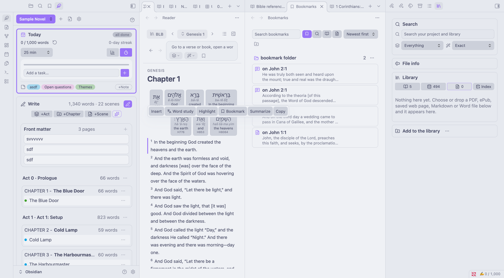

## Words you lean on
Click a word in **Words you lean on** on the Stats page to turn it into a character, place or other world entry, add it as an alias to an existing entry, or hide it from the list. Words that already match a name, place or alias are left out. All bars in a group share one width scale.

## Section dates in export
In **Advanced** export settings, **Section dates** controls how a date written at the top of a section (its story date) is printed: show or hide, alignment (centred by default), size, italic or bold. Works in Word, ePub and PDF.

## Importing a Markdown manuscript
The hub's **Import** button (top bar), or Project settings → **Import a manuscript…**, replaces the old drag-and-drop converter. Pick a Markdown, text, Word, OpenDocument, RTF or ePub file; Booker shows how many acts, chapters and sections it found, then adds them after what the project already has.
- A heading (any level) becomes a **chapter** and its text becomes the chapter's title. Attributes such as `{#anchor}` and heading links are removed.
- A heading starting with **Part** or **Act** starts a new **act** named after it.
- Lines of `***`, `---` or `* * *` split a chapter into **sections**, named *Scene 1*, *Scene 2*… counting through the whole book (the standard numbering).
- Text before the first heading goes into a chapter called *Introduction*. Headings inside code blocks are ignored, and properties at the top of the file are dropped.
- Imported sections get the status *draft*. The import has an Undo link.

## Where things open
- **Writing** (a chapter or scene you click in Booker) opens in the **left pane** of the writing area. If that pane only holds charts, the note opens in a new tab beside them.
- **Charts and pages** (Board, Plotlines, Timeline map, Stats, Story checks) open in the **right pane** when two or more panes are open. With a single pane they split to the right when the writing area is wide, and otherwise open as a new tab in that pane.
- Both are set in Booker's plugin settings: **Open chapters in**, **Open charts and views in** and **Wide window from** (the width in pixels from which the window counts as wide; open sidebars narrow the writing area).

## The Import button

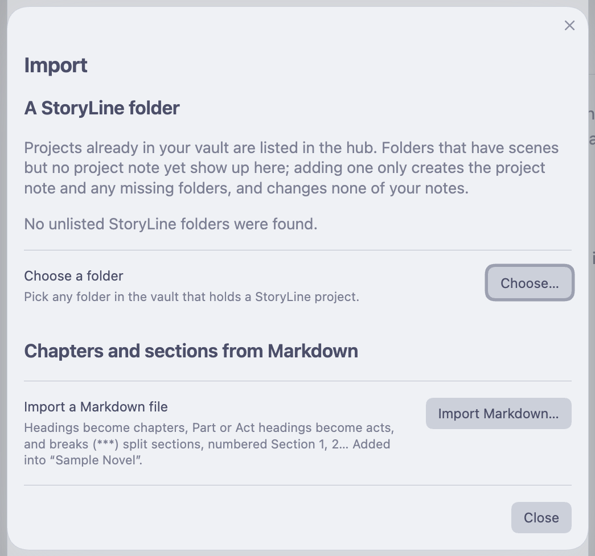

*The Import window.*

The **Import** button (arrow into a page) sits in the hub's top bar beside the ⋯ menu. It opens one window with two ways in:
- **A StoryLine folder.** Folders that hold scenes but have no project note are detected and listed with **Add as project**; **Choose…** lets you pick any folder in the vault. Adding a folder only creates its project note and any missing folders and System files; none of your notes change. A folder that is already a project is just shown.
- **Chapters and sections from Markdown**, as described above.

The hub's **Export** card is centred: the quick exports (Word, ePub, PDF), then two larger buttons, **Custom Export** (formats, layout and advanced settings) and **Show folder**.

## Scene numbering

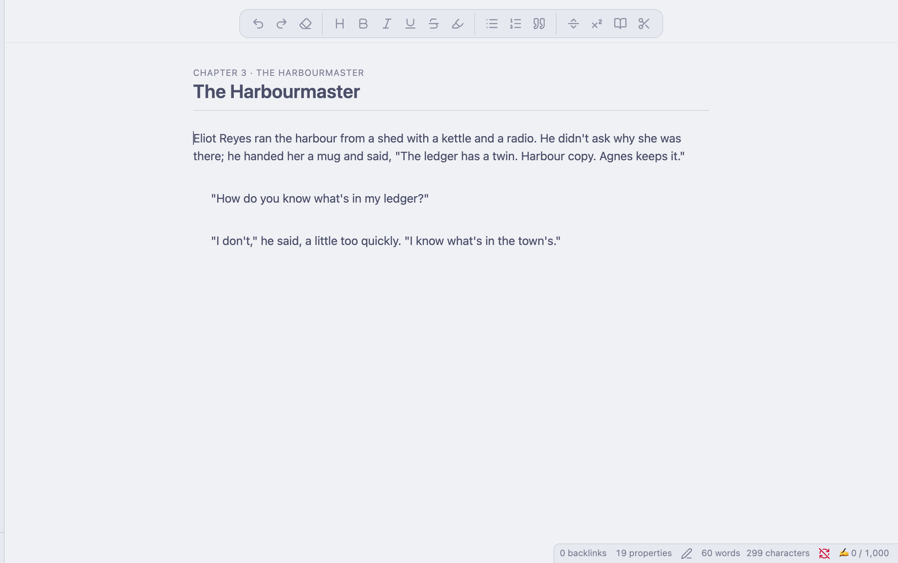

*A scene with its generated title: the chapter above, then "Scene N" and the title.*

With **Number scenes across the book** on (the default for new and imported books; Project settings turns it on for older ones), scenes are called **Scene 1**, **Scene 2**… counting through every chapter, so chapter 2 continues where chapter 1 stopped. A scene with a title of its own reads **Scene 3 - The Title**. Adding, deleting, moving or splitting scenes renumbers the rest within a second or two; to retitle a scene just type the new title and the number is put in front of it. Turning the setting on renames the scene titles in that book.

## The title above a scene
In a scene note the editor shows a generated heading instead of the file name: the chapter and its name in small capitals, then the scene title ("Scene 3 - The Title"). It is drawn by Booker and is not part of the text, so it is never exported twice or counted as words. The title itself stays in the note's properties and the file name stays as it is, so other tools that read them keep working.

## Where new projects go

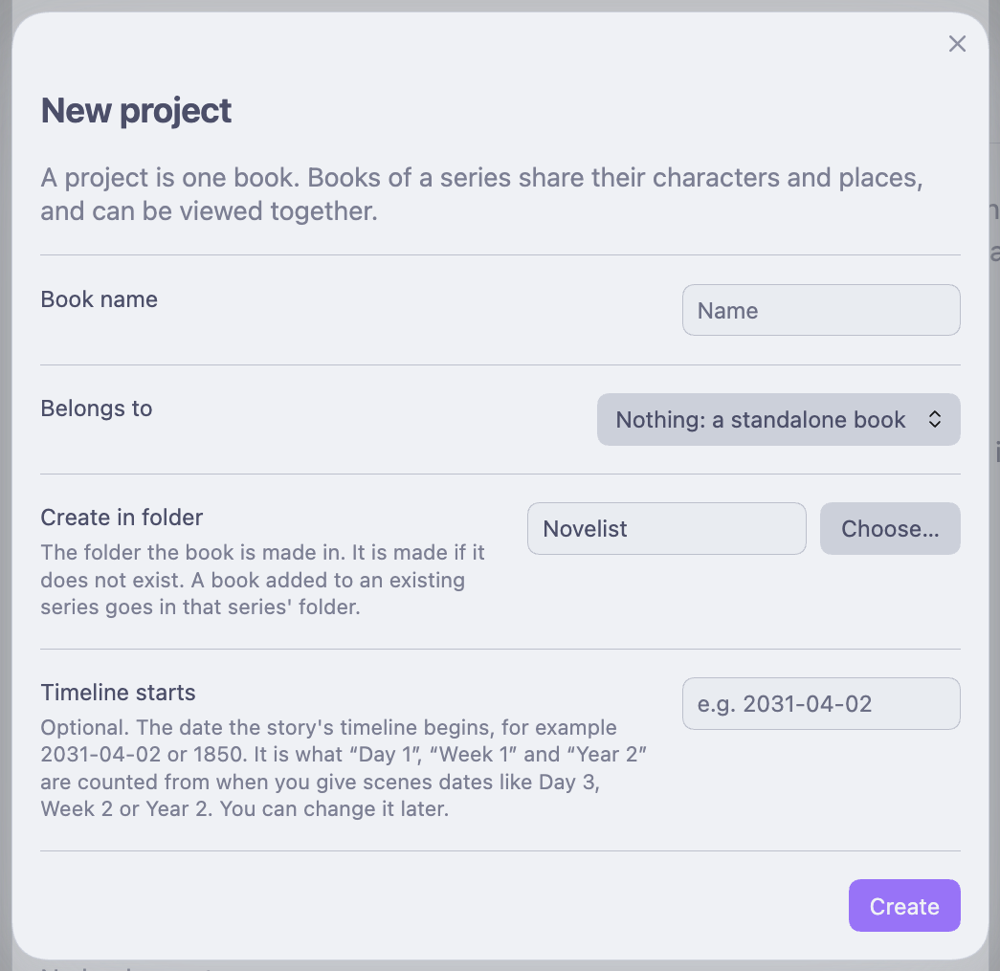

*The New project window, with the folder to create the book in.*

New projects are made in a folder called **Booker**. The New project window has a **Create in folder** field (with a Choose… button) to put a book somewhere else, and the plugin settings have **Folder for new projects** to change the default. Books already in other folders, such as an older `StoryLine` folder, are still found and keep working.

## New notes start with all their properties
A new character, place, item, creature, lore entry, culture, system or life, and a new scene, is created with every property already in the note (empty): aliases and the profile fields for a codex entry; synopsis, POV, characters, place, dates, tags, conflict and emotion for a scene. They show in Obsidian's Properties and in the inspector, where you fill them in. This applies wherever you create them: the the Codex card, the Words you lean on menu on the Stats page, the board and the hub.

## Lives in a sequence

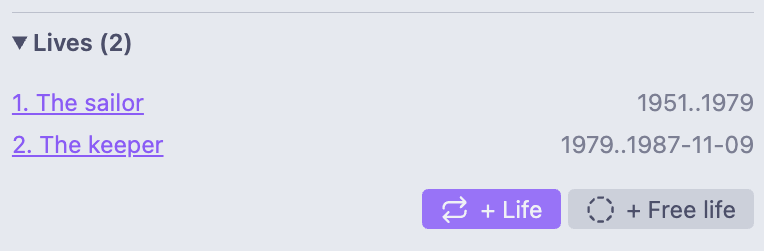
Open a character and the **Lives** section lists each life with its number and dates. **+Life** adds the next life in the sequence: it gets the next number and, if the life before it has an end date, starts a gap after that end (three days unless you change the gap in the Lives settings, see below). **+Free life** adds a life with no number; it floats free and is drawn grey on the timeline map until you give it a **Sequence** number in its properties.

Lives are the first of Booker's *sequences*: every Codex category can work the same way (see the next section). Open **Codex**, choose **Lives** and use the gear to change the default gap or what lives can be anchored to; the Lives switch is always on.

On the timeline map, lives in a sequence keep their gaps. Drag a life's end and only the start of the next life follows; drag its start and only the end of the life before it follows; move a life and both happen. Hold Shift while you let go and every later life moves together instead. Free lives never move with the others.

## Sequences for any Codex category

A sequence is a list of notes that follow each other in story time: a character's lives, the eras of a world, the jobs someone held, the places they lived. Each item is numbered, has dates, and starts a set gap after the one before. An item can also be **anchored** to any other note, so that it starts when a scene, an event, a character or another item says it does. Any Codex category can be a sequence. Everything is done from the **Codex** card in the hub; no commands are needed.

### Turn a category into a sequence

In the hub's Codex card pick the category (Events, Places, or a category you added, such as Eras), then click the **gear**. The **Sequence** box is at the bottom of the settings.

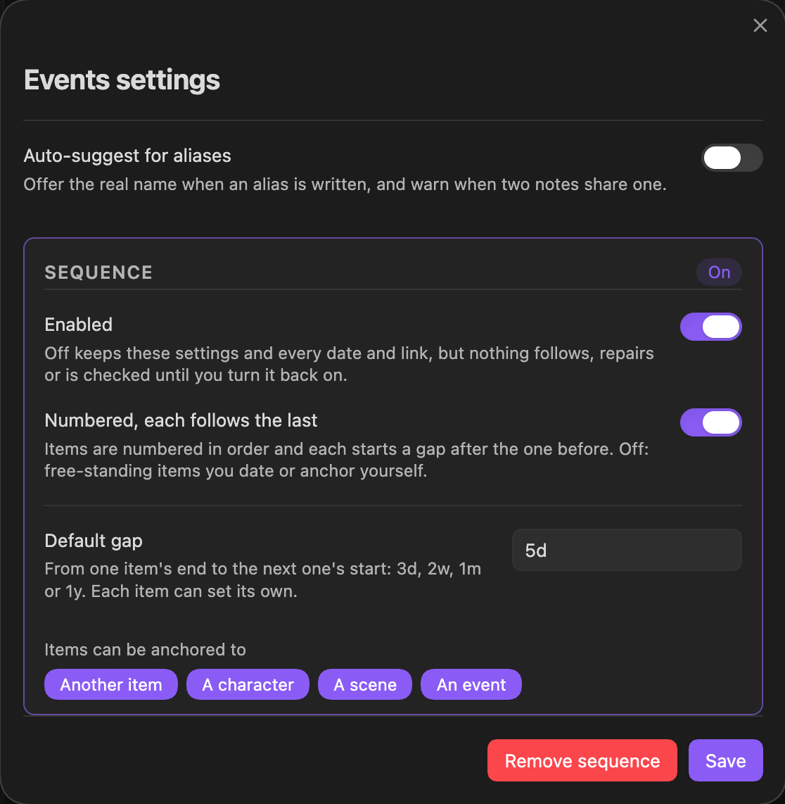

*A category's settings, with the Sequence box.*

- **Make this category a sequence** (later called **Enabled**). Turning it on marks the category's existing notes as part of it; this can be undone. Turning it off again is safe: see below.
- **Numbered, each follows the last.** On: items are numbered 1, 2, 3 and each starts a gap after the one before. Off: items are free-standing and you date or anchor each yourself.
- **Default gap.** The time from one item's end to the next one's start: `3d` (days), `2w` (weeks), `1m` (months) or `1y` (years). Each item can set its own.
- **Items can be anchored to.** Choose the kinds of notes the category's items follow: another item, a character, a scene or an event. With *A character* on, a new item also records whose it is.

Press **Save**. The category now shows number badges and dates, its **Add** button opens the full new-item box, and **Check** and **Repair** buttons appear.

**Switching it off.** Turn **Enabled** off and Save to pause a sequence. Booker keeps the settings, the marks on the notes and every date, number and anchor, but nothing follows, repairs or is checked, the timeline treats the notes as ordinary dated notes, **Add** is a plain name box, and the card says *Sequence is off for this category*. Turn it back on and everything resumes.

**Removing it.** **Remove sequence** (a red button, shown for a category that has been a sequence) deletes the sequence settings and takes the marks off the notes, after asking. The dates and links stay in the notes. It can be undone. Lives cannot be switched off or removed.

### Add an item

Click **Add** in a sequence category (or **+Life** on a character). The box asks:

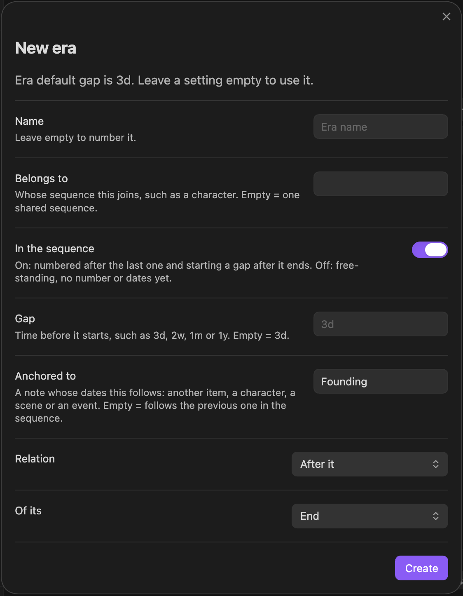

*The new-item box, with an anchor chosen.*

- **Name.** Leave it empty to number it (for example *Ann Era 1*; lives are named *Ann 1*).
- **Belongs to.** Whose sequence this joins, usually a character. Items are numbered separately for each person and each category, so Ann's lives and Ann's eras never mix. Leave it empty for one shared sequence for the whole category, which suits things like the eras of a world.
- **In the sequence.** On: the item is numbered after the last one for that person and starts a gap after it ends (if the last one has no end date yet, the new one has no date either). Off: a free-standing item with no number or dates yet.
- **Gap.** This item's own gap (`3d`, `2w`, `1m`, `1y`). Empty uses the category's default, shown in the box.
- **Anchored to.** Any note in the book: another item, a character, a scene or an event. Empty means the item follows the previous one in its sequence. Start typing and Booker offers the notes' names.
- **Relation** (shown once an anchor is chosen). *After it*: the item starts the gap after the anchor. *At the same time as it*: the item starts exactly then. *Before it*: the item ends the gap before the anchor starts, and keeps its length.
- **Of its.** *End* or *Start*: which edge of the anchor the item is measured from.

The new item starts where its anchor says. If the anchor is a single day (an event, or a scene with one date) that day counts as both its start and end. An item in a sequence that has only a start date goes on indefinitely, so nothing can be measured from its end until it has one.

### What is stored in the note

Everything is in the note's own properties, so it is plain text you can read and edit. The category's settings are in `System/templates.json`.

| Property | Meaning |
|---|---|
| `template` | The sequence this note belongs to (set when a category becomes a sequence). |
| `sequence` | Which list it is in: the sequence and whose it is, such as `era/Ann`. |
| `number` | Its place in the list; empty for a free-standing item. |
| `storyDate` | When it runs, such as `1342-05-03` or `1342-05-03..1342-06-01`. |
| `anchor` | The note it follows, as a link such as `[[Founding]]`. |
| `anchorMode` | `after`, `with` or `before`. |
| `anchorEdge` | `start` or `end`: the anchor's edge it is measured from. |
| `gap` | This item's own gap. |

The inspector shows these under **Time link** (*Anchored to*, *Relation*, *Of its*, *Gap*) for a note in a sequence category; a life shows *Anchored to* and *Gap* among its other fields. Change them there and the next **Repair** applies them.

### Keeping it in step: Check and Repair

Booker works out where each item should start from its anchor and gap, and compares that with the date in the note. **Check** reports what is wrong; **Repair** fixes the dates.

- **Check** finds: anchors that form a loop; an anchor that no longer exists; a date or gap Booker cannot read; numbers that are repeated or skipped; an item that starts before the one before it ends; an item that starts before its anchor; and dates that differ from what the anchor and gap give. The same findings appear in **Project health** under **Sequences**, and a short check runs quietly a few seconds after you open the vault, saying something only if there is a problem.
- **Repair** first shows every date it would change, as *old → new*, and asks. It then changes all of them or none, skips any note you edited in the meantime, refuses to run while anchors form a loop, and can be undone from the notice that appears.

Dates that you set by hand and that differ from what the anchor and gap give are reported as *dates differ*, and **Repair** would put them back to the computed date. Read the preview before accepting: to keep a different date for good, change the item's anchor or gap instead.

### On the timeline map

Items in a sequence behave as lives do. They share a row at the top of their lane; drag one and the neighbours follow so the gaps stay as they were; hold Shift and every later item moves together. A free-standing item is drawn grey. Dragging moves the dates but not the anchor, so **Check** may then report that the item differs from its anchor; **Repair** or a change of anchor settles it.

### Commands

Everything above is in the hub, but each part is also in the command palette: **Check sequences**, **Repair sequences**, **New sequence template**, **New item from sequence template** and **Sequence template settings**.

## The Map

The **Map** puts your story on the real world. It sits next to the Timeline map: the **Map** button on the hub's Plan card (and the toolbox menu), the command **Open the map**, or the ribbon list. Scenes, chapters, places, characters, events and any other Codex note can have a location, and everything that has one is a pin.

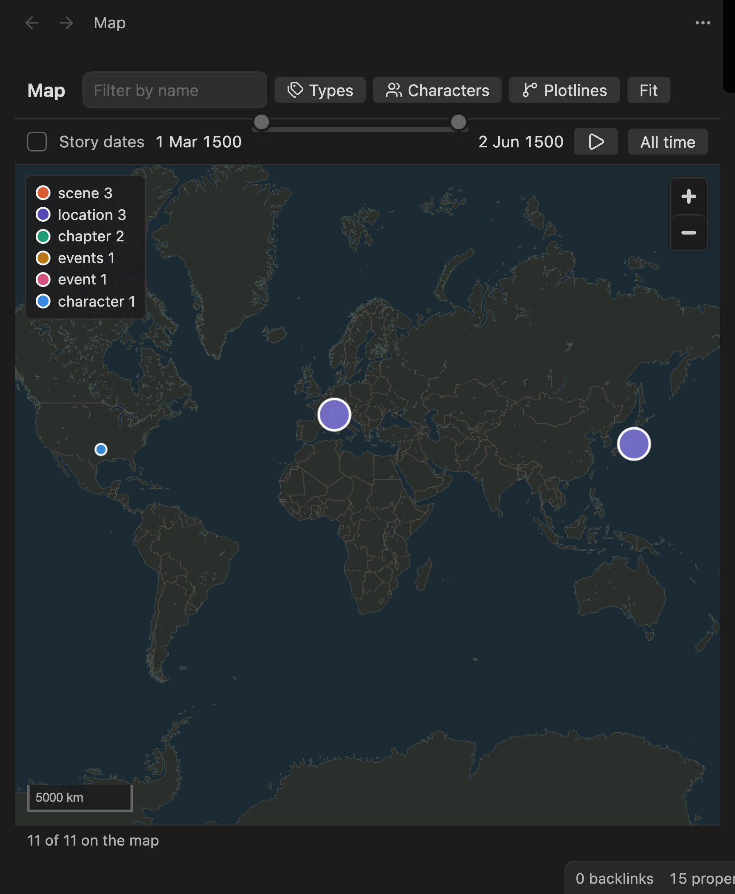

**What you see.** The map fills the whole pane, edge to edge, and the controls float over it as frosted glass. **Top left:** the map picker (the real world and your drawn maps), a search box that filters by name, and **Filters**. **Top right:** zoom in and out, **Fit** (zooms to everything shown), the grid on and off, and **Maps settings**. **Bottom:** the story-date dock, with the count of what is on the map above it. Controls rest at lower strength when you are not using them. Drag to pan, scroll or pinch to zoom. Pins that are close together join into a larger circle; click it to zoom in. Hover a pin for its name, type, story date and place; **click** it to select it (a ring and a small card with **Open** and **Move**), **double-click** it to open the note, and **right-click** it for the menu. The map follows the project picked in the hub; in a series, choose *This book* or *Whole series* under Filters.

**Where a pin comes from.**

- A note's own location, when you gave it one.
- Otherwise the place it links. A scene whose *Place* is the Codex note *Paris* is pinned where *Paris* is, so you only locate each place once.
- A **chapter** has no note of its own, so it is pinned at the centre of its scenes and takes the span of their dates.

Notes with no position anywhere are simply not shown. The count above the time dock says how many are on the map.

**The date window.** The dock along the bottom shows the span of your story. Move either handle to show only what happens between two moments of story time, and press **Play** to slide a window of that size through your story and watch the action travel. **All time** puts it back. Pins with no story date stay on the map unless you turn off *Show places with no story date* under Filters. Dates come from each note's `storyDate`, so Day 3, ranges and approximate dates all work as on the timeline. The dock only appears when something on the map has a date.

**Filters.** The **Filters** button opens a sheet under it: *Types* (each with its colour and how many pins; scene, chapter, location, character, event, life and any category you added), then *Characters*, *Plotlines* and, for a series, *Books* and *Scope*. Tick what you want to keep; the button shows how many filters are on, and **Clear filters** resets them. Your choice of types is remembered for the book (in `System/map.json`).

### Giving something a location

Open the note and find **Location** in the inspector (scenes and every Codex note have it). Type where it is and press Enter:

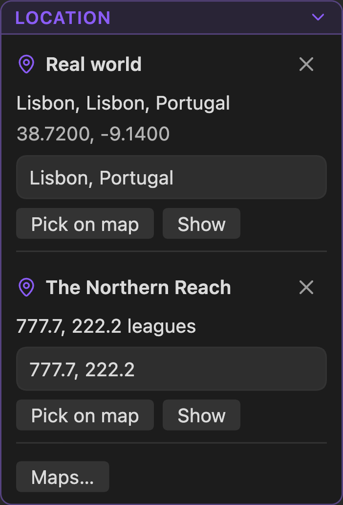

- **A city, with a state or country** if you like: *Paris*, *Paris, Texas*, *Lyon, France*, *Springfield IL*.
- **A zip or postal code**, with or without a country: *10001*, *75001 FR*, *SW1A 1AA*, *M5V 3L9*.
- **Coordinates**, latitude first: *48.8566, 2.3522*, *40.7N 74.0W* or degrees, minutes and seconds.

If one place clearly fits, it is used. If several do (there are many Springfields), Booker lists them, biggest first, and you click the one you mean. The note keeps what you typed in `address`, the position in `geoLat` and `geoLng`, and the name it resolved to in `geoPlace`; these are ordinary properties, so you can also edit them yourself or write them in bulk. **Clear** removes the location.

**Place data.** Finding a city or zip by name works offline from lists you download once. In the **Resource manager**, under **Maps**, press Download on *Places: cities and regions* (about 3 MB; about 25,000 cities of 15,000 people or more) and, if you want zip and postal codes, *Places: postal codes* (about 30 MB to download, about 130 MB on disk). The data is from GeoNames (CC BY 4.0). Until you download it you can still type coordinates. Street addresses are not looked up: type the city, or the coordinates.

**The map itself.** The world map is Natural Earth (1:10m, public domain), included in Booker's folder, so the Map works with no internet. It shows coastlines, lakes, rivers, country borders and state or province borders as you zoom in; it does not have streets or town names. Booker draws it with MapLibre (WebGL). If your computer has no working WebGL, or only a slow software version of it, Booker switches by itself to a compatible map that draws the same data (a lighter 1:50m copy) with Leaflet, and says so at the top of the map. You can choose the engine yourself in **Maps settings → Display engine and checks**.

### Naming places and stacked pins

**Naming a place on the map.** Right-click empty map and choose **New place here…**, type a name, and Booker creates a place in your Codex (a Codex *location* note) at that spot, on that map. From then on the name works everywhere: type it as a scene's **Place**, or write it (or an alias) in a scene's text with name detection on, and the scene sits at that spot. If the name already exists, Booker asks whether to move that place here. **Copy position** in the same menu copies the coordinates. A place is positioned per map, so give it a position on each map it belongs to.

**Several pins close together.** Pins that are close together on screen (every scene set at the same place, say) show as one grey badge with their number, whether or not anything is selected. **Click** the badge and the pins fly out in a circle round it, oldest first. Click one to select it, double-click to open it, right-click for its menu; click the middle (it shows how many there are), press Esc, or drag or zoom the map to fold them back. Very large groups use more rings. Zoom in and pins that are far enough apart stand on their own again; zoom out and they gather.

### Moving a pin

**Double-click** a pin to open its note. **Right-click** it for a small menu: **Move** or **Open item**. Move lifts the pin off the map with a shadow under it and a dotted ring round it. Drag it where it belongs; it trails the pointer on a spring and settles. **Double-click it** to set it down, or just wait: ten seconds after you last move it, it sets itself down and the new position is saved. While it is lifted, right-click gives **Set down here**, **Put back** or **Open item**, and **Esc** also puts it back. It works on the real world and on drawn maps, saves in one step you can undo, and a scene that takes its position from a place gets a position of its own when you move it. A chapter pin sits at the centre of its scenes; move it and it stays where you put it (saved with the map settings, on that map only). Right-click it and choose **Reset to the centre of its scenes** to let it follow its scenes again.

### Drawn maps and several worlds

A story does not have to happen on Earth. Add **drawn maps** (a painting, a scan, a sketch, or just graph paper) and place anything on them, just like on the real world.

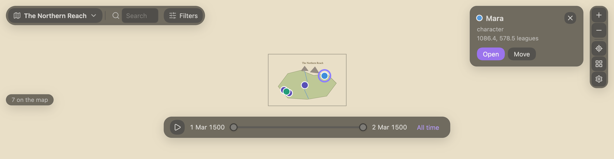

Open **Maps settings** from the gear at the top right of the Map, the command **Maps settings**, the **Maps…** button in a note's Location box, or Settings → Booker → Maps. A panel slides in over the right side of the map, and what you change shows on the map straight away. At the top, a switcher lists the real world and each drawn map (right-click one to move, duplicate or delete it; **+ New map** adds one). Below it, the chosen map's settings are grouped in lists: Picture (with a preview of the grid over it), Coordinates, Grid. At the bottom, *This computer* holds the display engine and *Checks* the notes placed on a map that no longer exists. **Done** closes it.

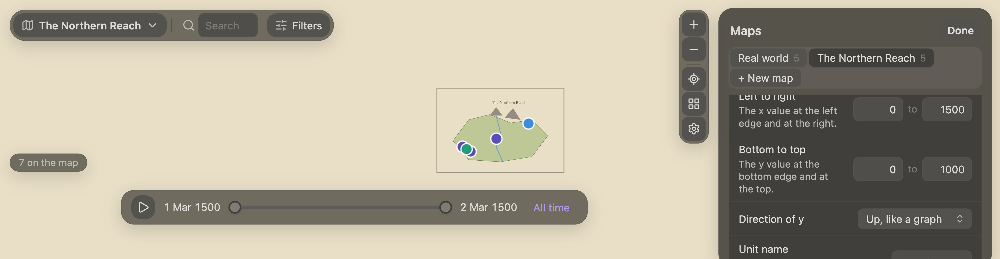

- **Picture.** *Import from computer* copies a png, jpg, webp, gif or svg into the book (`System/maps`, so it moves with the book), or *Choose from vault* uses a file already there. Without a picture the map is a plain grid. *Strength* fades the picture so the grid shows through. If the file goes missing the map still works and the window offers to choose it again.
- **Coordinates.** Any range you like: 0 to 1000, 0 to 100, −1000 to 1000, 0 to 1, the picture's pixels, or numbers of your own, with a unit name (leagues, miles) and the direction of y (up like a graph, or down like pixels). The picture is stretched over the range, so positions do not change if you swap in a bigger picture.
- **Grid.** Show or hide it, and set the spacing (or leave it automatic: it follows the zoom), the thin lines between, the colour, the strength and whether numbers are shown. The real world has its own grid of latitude and longitude.
- **Several maps.** Add as many as you want, in any order, rename, duplicate or delete them; the Map tab has a picker. The date window and every filter work on each map.
- **Switch the real world off** for a story set only in invented worlds: the world map, the city and zip lookup and the latitude and longitude on notes are hidden. What is already saved on your notes is kept, and turning it back on restores it.

A note can be on **one position per map**. In the inspector's **Location** box each map has its own row, and **Add to a map…** adds another. On a drawn map type `x, y` in its own units (for example `412.5, 188`), or click **Pick on map** and then click the map (the cursor shows the coordinates as you move). A position outside the map's range is kept and marked. Positions are saved in the note as `mapPos: ["reach: 412.5, 188"]` (the map's id, then x and y), next to `geoLat` and `geoLng` for the real world. A scene without a position of its own uses the place it links, on the same map; a chapter sits at the centre of its scenes on each map.

**Display engine.** Under *Display engine and checks* choose Auto (the default), WebGL or Compatible for the real-world map. This is kept on this computer, not in your book, because it depends on the computer. Drawn maps always use the compatible engine, which suits flat pictures and works everywhere. The same page lists notes placed on a map that no longer exists and can clear those positions.

## Family tree

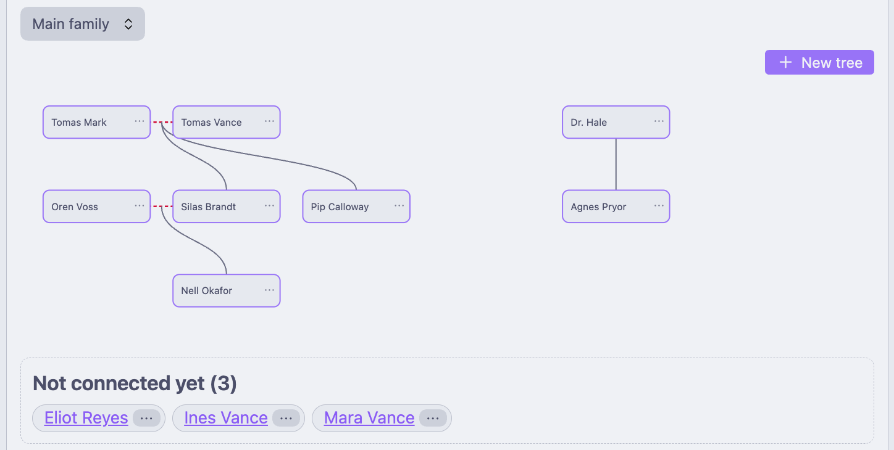
The **Family tree** icon on the ribbon (also in the hub's ⋯ menu under Plan) draws a node map of your characters: parents above their children, partners side by side with a dashed line between them. Click a person to open their character note. The **⋯** on a person (or right-click) lets you add a parent, partner or child, picking an existing character or creating a new one on the spot, and remove any of those links. The same links are the **Parents** and **Partners** fields in the character's Family section in the inspector, so the map updates as you write.

The **Main family** tree shows every character. People with no links to anyone are set apart in **Not connected yet** underneath; link one and they join the tree. **New tree** makes another tree (a royal house, a second family): use **Add person** to choose who is in it, and **Take out of this tree** on a person's ⋯ menu to remove them. Links belong to the characters, so a person in two trees keeps the same parents and partners in both.

On the timeline map, a character's lives show in that character's lane when you add the character: all of them in one row at the top of the lane, above their scenes. A lane of Everything (or of a kind, place or plotline) leaves lives out, so add the character to see them.

The timeline map has a title, with the sources at the top and the filter and zoom bar directly above the lanes. The **playhead** is a vertical line with a flag on the axis. It is placed when you click the time line at the top, or when you click a bar (it goes to the middle of that bar). Zooming (the + and − buttons, Ctrl/⌘ + scroll or a pinch) pivots on the playhead: it stays where it is on screen while everything else scales around it, and it is centred if it had scrolled out of view. Click the flag to remove it. With no playhead, zooming pivots on the selected bar, or on the pointer. The **+Custom** button at the right of the filter bar shows or hides the box under it, which holds the sources and a row of dropdowns (Character, Scene / Chapter, Place, Plotline, Life, More) that add a lane in one step.

## Your own book templates
Under Settings → Your own book templates, **Open templates file** creates `Book templates.json` in your projects folder with one worked example (a poetry collection) and opens it. Edit it to describe your own kinds of book: `levels` (what the divisions are called), `statuses`, `worldKinds`, `views`, `features`, `frontMatter`, `backMatter` and `citationStyle`. Anything you leave out is copied from Fiction. Save the file and the new template appears in the New project window. A template with a built-in id (such as `fiction`) replaces that one. Existing books keep working because they only remember the template's id.

## Front and back matter
A new book starts with the pages its kind of book usually has: for example Foreword, Preface and Introduction before the text, and Appendix, Notes and Index after it. They are notes in the book's `Matter` folder, listed in the hub under *Front and back matter*; click one to write it, or use + to add your own (Acknowledgements, Glossary…). On export, a page is printed only when it has text, so empty ones cost nothing. Use the up and down arrows beside a page to change its order. The title page, copyright, dedication and bibliography are made for you from the book's settings and citations.

In the New project dialog you can also set how many empty chapters (or entries) to start with, and the citation style (APA, MLA, Chicago or SBL); the kind of book picks a sensible one by default.

## Importing Word, OpenDocument and ePub files
The hub's **Import** button also takes `.docx`, `.odt`, `.rtf` and `.epub` files, as well as Markdown and text. Booker turns the file into Markdown first, so the same rules apply: headings become chapters, Part or Act headings start a new act, and `***` lines split sections. Bold and italics are kept, and footnotes in Word and OpenDocument files become inline notes that stay with their paragraph. Google Docs and Pages files go through *Download as Word* (or *Export to Word*) first. RTF files have no real heading styles, so Booker guesses: a short line set larger than the body text becomes a heading (the largest size is the chapter level). Footnotes in RTF files are not kept; use Word or OpenDocument when you need them.

## Callouts: summaries, questions and epigraphs
Obsidian callouts print in the exported book as a quote. `> [!summary] In short` followed by lines of text becomes a quote that starts with a bold **In short.**; with no title it starts with the kind (`> [!question]` gives **Question.**). Use `> [!epigraph]` or `> [!quote]` for a plain quote with no label, such as a key verse at the start of a chapter. Use them for chapter summaries, reflection or discussion questions, and sidebars.


## Importing a StoryLine folder

The hub's Import button lists StoryLine folders that are not projects yet. **Copy as project** copies the whole folder next to the original as `<Name> (copy)`, makes the copy a project, and reports how many files, scenes and world notes came across (and any that could not be copied). The original is never changed. **Add in place** instead turns the folder itself into a project by adding the project note and missing folders.

## Import options and preview

After you pick a manuscript file, the import window shows a preview of what it will become (acts, chapters and how many sections each has) and updates it as you change three choices: **Chapters come from** (every heading, or only down to heading level 1, 2 or 3; deeper headings stay in the text), **Acts start with the word** (default *Part, Act*; add *Book* or *Volume*, or empty it for no acts) and **Extra section break** (another line, such as `# # #`, that splits sections; `***` and `---` always work). Nothing is written until you press Import, and the import can be undone.

## Sermon outlines and first steps for each kind of book

**Sermon outlines** is a kind of book with three levels: series, sermon and point. It uses scripture, footnotes and citations, and keeps Texts, Illustrations and Applications as world notes. Choose a sermon shape in Story checks and **Add scenes** lays out the outline (for the expository shape: Hook, Text and context, Big idea, three Points, Illustration, Application, Gospel connection, Closing and prayer).

The hub's **Today** list starts with first steps that depend on the kind of book. A sermon lists: create the sermon or series, choose a sermon shape, add the first point, add a Bible, add an illustration, write 100 words. A history lists a source and a person, place or term; a dictionary lists a source for etymologies; fiction lists characters and places. Steps tick themselves, and the current one has a button that does it (choose, add Bible, add source, new scene). Hide any step with its ×.

A profile you write yourself can include `beatSheets`: a list of `{ id, name, summary, actLabels, beats: [{ act, label, description }] }`.

## Statuses for each kind of book

A scene's or section's status follows the kind of book. Fiction, Christian non-fiction, history and self-help use idea, outlined, draft, written, revised, final. Educational uses idea, outlined, draft, reviewed, final. Sermon outlines use idea, outlined, draft, rehearsed, preached. Reference and dictionary entries use stub, draft, reviewed, final. The inspector, the progress bar in the hub and Writing stats, and the export window's "Include scenes at or above" all use the book's own list, and new sections start at its first status. A profile you write can set its own list with `statuses`.

## Index terms panel

The command **Index terms (rename, merge, add)**, and the **Index** button on the hub's Research card, open a list of the words and names in the back-of-book index. Each shows the chapters it appears in, or says it was not found and will not print. **Rename** changes what is printed and keeps the old spelling matching. **Merge into…** makes one entry cover both: merging Zion into Jerusalem prints one line, Jerusalem, with the chapters of either word. The trash button removes a term, and you can add one by typing it and pressing Enter. The list is saved in the project note as `indexTerms`; an entry with other spellings is written `Jerusalem|Zion`.

## Saved verse styles and a Bible for each book

In the Insert scripture window, the **Saved styles** row lets you name the current look (layout, verse numbers, reference place and so on) with **Save as…**, switch to a saved style from the list, or **Delete** it. **Use for this book** makes the book write verses from the chosen Bible, in the chosen saved style, whenever you insert or quote scripture in it (a sermon series in the NIV, a study in the BSB). It is stored in the project note as `bible` and `verseStyle`; remove those two properties to go back to the global choice. A book with its own choice keeps it when you change the Bible in the window for one insertion.

## The library browser

The Library is part of the Reader (command *Open the library browser*, or the **Library** button on the hub's Research card): choose **Libraries** from the Source button to see the shelf.

**The Library opens on a shelf of databases**, not a list of every document: *Bibles*, *Commentaries* (your e-Sword and MySword modules), each collection you added (for example *Church Fathers: Writings* and *Church Fathers: Commentaries*), and *Documents and books*. Pick one and it opens the way that suits it:

- **A collection of works** (the Church Fathers, Josephus and the like) opens as a list of its **works, under grey author headings**, with filters for author, year range, category and **ANF/NPNF volume**, a box to filter by words, and sorting by author, title or date. Works that appear in the Ante-Nicene Fathers (ANF 1–10) or the Nicene and Post-Nicene Fathers (NPNF series 1 and 2, volumes 1–14) show the volume, for example *ANF 3–4* or *NPNF1 1–8*. The volumes come from a built-in table by author; authors in neither set show none. Undated works are left out when you filter by year.
- **A work** opens to read with **drop-downs for its levels** (Work, Book, Chapter, Section, whatever it has) and arrows for the previous and next entry; the button at the right shows or hides the full contents tree. A dictionary shows **Letter** and **Entry**. Scripture references in the text are clickable. Documents have a **Highlights and quotes** button.
- **A commentary** opens as a book: **Book** and **Chapter** drop-downs and every note of the chapter, with the verse you came from highlighted. The References tab has an **Open commentary** link beside each commentary that opens it at the verse you are on.
- **Bibles** takes you back to the reader.

The one box searches here (the open Bible, work or database), everything, or only documents; the first search of a library builds its index, which can take a while and is kept after that. The place you were reading is remembered with the pane.

## Searching the readers

Two small boxes inside the search box choose **where** and **how** to search.

- **Where:** *Current page* colours every match on the page you are reading and says how many there are. *Current work* searches the open Bible, work or database. *Current database* searches every Bible, or every work in the same library. *Library* searches all your libraries and documents. *Everything* adds the open Bible. *Documents* searches only your documents. *My writing* searches every note inside your projects (scenes, notes and the Codex); *Everything* includes it too. Notes are read again only when they change, and the meaning index of your writing is kept in the plugin folder.
- **How:** *Exact* finds the words as typed. *Fuzzy* also finds other forms of a word (*justify*, *justified*, *justification*), the start of a word, and a one-letter slip. *Semantic* finds passages by what they say: searching *undeserved kindness* finds a passage about grace that never uses those words. It is offered once a model is installed (Settings → Search by meaning). Meaning results are mixed with word matches, and this covers Bibles too: the first meaning search of a Bible indexes its verses (about a minute for a whole Bible) and keeps the index in a `.vec` file beside the module.
- The first meaning search of a library makes its index and keeps it in a `.vec` file beside the library, so it travels with the library. *Index every library now* in settings does them all in one go. Everything runs on your computer from the models inside the plugin folder; nothing is sent anywhere.
- **Save this search** (in the results) names a search and puts it in a group. The bookmark button in the search box lists saved searches; groups nest like folders (*Doctrine/Grace*), and right-clicking a group or a search renames, moves or deletes it.

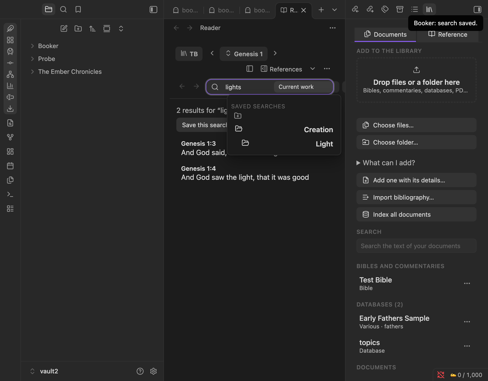

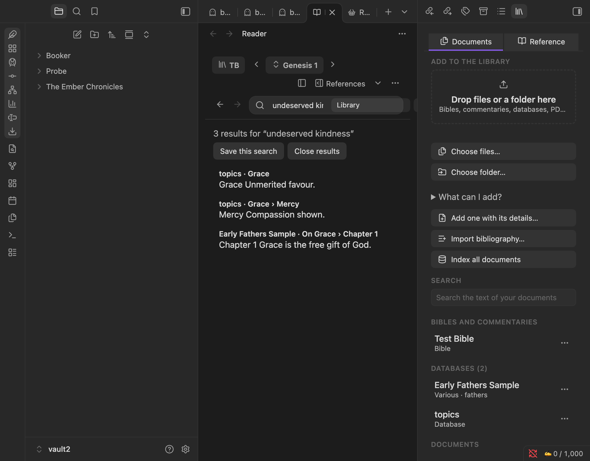

## Selecting text in the readers

Click a verse to select the whole verse; shift-click another to select everything between, and cmd-click (ctrl-click on Windows) to add or remove single verses. Drag across the text to select just some of the words. The same works on the paragraphs of a library or document. With verses or paragraphs selected, cmd+C copies them, the toolbar's **Insert** button writes them into your note, and dragging them into a note drops the text where you let go. The References tab follows the whole range (*John 3:16-18*) and shows the notes for every verse in it. A small toolbar appears under the selection: **Insert** writes the words into the note you were last in, as a block quote with a footnote; **Highlight** colours them (yellow, blue, green or pink) and keeps the highlight; **Bucket** keeps them in the reference bucket; **Copy** copies them. Selecting words in a library or document gives Insert, Bucket and Copy. The References tab works the same way: click a commentary note, shift-click or cmd-click more, or select words inside one, and the same toolbar appears. Everything you copy (cmd+C, the toolbar's Copy, right-click Copy) or drag out of the Bible, a library work or a commentary, in the Reader or the References tab, carries where it came from. Pasted or dropped into a note it becomes a block quote with a footnote (*BLB, John 3:16-18.*, or *Irenaeus, in Church Fathers Commentary, on John 1:1.*); pasted anywhere else it is the words followed by a line naming the source.

The **reference bucket** (command *Open the reference bucket*, or the ⋯ menu of the reader) holds everything you have kept, with its citation, the archive it came from, the book and the chapter. Filter by any of those or by your own topic tags, add a topic to an item, write an item into a note, or remove it. The bucket, saved searches and highlights are small files in `Booker/Library`, so they move with your library.

## Summaries

The command **Summarize the selection or this note** (and, in the reader, the **Summarize** button on selected words and the *Summarize this section* link over a long entry) picks the sentences that best stand for a text. It works from meaning: it finds the middle of what the text says and keeps sentences close to it that do not repeat each other, then shows them in the order they were written. Every sentence is the author's own; nothing is written or invented. A slider sets how many sentences (about a tenth of the text to start with). **Insert into note** writes them as a `[!summary]` callout; **Copy** copies them. It needs a model installed, like searching by meaning, and runs on your computer.

Under Settings → Booker → Search by meaning, **Libraries and documents searched by meaning** lists every library and document with a switch. Switch one off to leave it out of searches by meaning and out of *Index every library now*; its words still search as usual. Its existing index is kept.

### Managing the indexes

Settings → Search by meaning → **Manage indexes** (or the command *Manage the indexes for searching by meaning*) lists every library and document with how much of it is indexed. **Index all** indexes everything not yet done; **Index ticked** does the ticked ones; **Clear and regenerate ticked** deletes their indexes and makes them again (useful after changing the model). **Stop** pauses and the work continues next time.

### Summarize with AI from a right-click

Right-click in a note, on selected words in a reading view, or on selected words or picked passages in the Bible and library readers, and choose **Summarize with AI** (with the writing model installed it opens on *Written summary*).

### Scene summaries in the background

This is **off until you switch it on** (Settings → Search by meaning → *Write scene summaries in the background*). With it on and the writing model installed, when you move on from a scene you have changed a good deal (a fifth of it and at least 100 words since the last summary, and at least 150 words in all), Booker (which notices that you left the note, whether you opened another note or another view) waits a few seconds and then writes two summaries on this computer, one scene at a time: a short one of three sentences, shown under the scene in the project hub, and a longer one, the **AI summary** in the scene's properties (`summary_ai`; the short one is `summary_ai_short`). The command *Write the AI summaries for this scene now* does it on request. Switch the automatic kind off under Settings → Search by meaning. A scene that already has a summary you wrote (the `summary` or `Synopsis` property) is never summarised automatically, is never touched, and its own summary is the one the hub shows under the scene; the AI summary appears only for scenes without one. Writing one by hand with the scene's ⋯ menu still works.

### The background task viewer

While Booker works in the background (scene summaries, indexing), a small spinning circle turns at the bottom right of the **Today** card in the hub. Click it to open the task viewer: every job with what it is doing, a progress bar, the time so far and a **Cancel** button (**Remove** for one still waiting). When nothing is running, a quiet tick stays there so you can reopen the viewer and see what finished or failed; **Clear finished** empties the list.

Summaries use the scene's POV and characters (from its properties) when the scene's text names them, so they say *Mara Voss* and not *she*. A scene needs at least 150 words for the automatic summaries, 40 when you ask for them yourself; one that is too short shows as **Skipped** in the task viewer, with the reason. When you ask for a summary, a notice shows the short one.

To write the summaries for one scene yourself, use the ⋯ menu on the scene in the hub and choose **Write AI summary** (or the command *Write the AI summaries for this scene now*). It runs at once and shows in the task viewer.

### Written summaries

With the optional **writing model** installed (download it from Settings → Search by meaning, or the Resource manager), the Summarize window offers a second kind, **Written summary**. The model, Qwen2.5-0.5B-Instruct, runs on your computer; only the download connects to the internet. It writes new sentences in its own words, so check them against the text before you rely on them; Booker marks the callout *written by* the model's name.

A long text is cut into parts of about 450 words at sentence ends. Each part is summarised, the part summaries are joined a few at a time, and the last round writes the summary at the length you chose (1 to 8 sentences). The window shows how many parts and steps this takes and an estimate of the time. If it would take more than about 45 seconds, Booker warns you and asks before it starts. While it works a progress window shows the part it is on, the time so far and the time left, with a **Cancel** button; cancelling stops at once and writes nothing.

## From a quotation to a timeline event

In the source reader, select words and press **Event** (shown when a book is open). A small window offers a name and a date: Booker looks for a date in the words you selected, then in the passage around them (10 June 1342, 1348, c. 1200, 586 BC, 13th century), and tells you whether the timeline can read what is in the box. **Add event** writes a note in the book's Codex, `Codex/Events/<name>.md`, with `type: event`, the `storyDate`, the quotation and a `[@key, page]` citation. Because it is a dated Codex note it appears on the timeline map, where you can colour it, drag it to change the date, and open it. This suits history books especially.


## The Booker sidebar

The right-hand Booker panel is one stack of foldable cards, like the hub. **Search** is on top: type, choose where (everything, your project, library) and how (exact, fuzzy, meaning) with the icon buttons, and the results unfold under the box. **File info** shows the open scene or codex entry with every field named in small light text inside its box, related fields grouped in rounded boxes (the scene tag sits right of the heading, act and chapter under the title); the everyday fields are open, and Story time, Craft, Setup and payoff, Snapshots (saved copies shown as cards, each with Compare, Restore and Delete) and the rest fold away. **Library** lists your Bibles and commentaries, databases and documents in three tabs; each item's three-dot menu has **Open file location**, and databases have **Map Fields…**. **Add to the library** has one **Choose source** button for files or a folder, and accepts drops; its three-dot menu holds adding one document with its details, importing a bibliography, indexing, and what can be added.


## Bookmarks and copy settings

**Bookmarks** (Research card, Reader menu, or the command *Open bookmarks*) keep saved searches, verses and references in one list. Each has an icon for what it is: a magnifying glass for a search, an open book for a verse, and the file type (PDF, Word, Markdown, ePub, commentary) for a reference. Press **Bookmark** on the toolbar that appears when you select words or click a verse, or on a reference's header, to add one. Make folders with the folder button (they nest), move a bookmark with its folder icon, and filter by kind, search the list, or sort it.

**Copy settings** (the three-dot menu of the Reader and of References) decide how copied or inserted words are written: verse numbers (as superscripts or plain), chapter numbers, "…" between verses that are apart, letters for footnotes, and quote block or inline. **Set default** keeps them for every window; **Use here** applies them until that window is closed.
